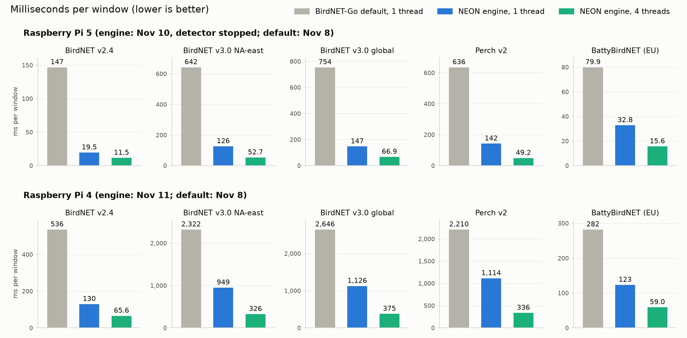

# birdnet-neon-engine: the libbnneon NEON engine

A NEON inference engine for bioacoustic classifiers on 64-bit ARM: BirdNET v2.4, BirdNET v3.0, Perch v2 and
BattyBirdNET-style heads. One C library (`libbnneon.so`) with a small C API (`src/bnneon.h`); the model file you
load decides what runs. A context runs on the calling thread, or on N threads for a compiled package
(`bnn_set_threads`; the outputs were bit-identical at every thread count checked, 1 to 4). It links only libc, libm and
pthread on Linux, and does no resampling. It is the engine behind an opt-in `neon` backend for BirdNET-Go (a binding not
published yet; see "Using it from other languages"), but nothing in it depends on BirdNET-Go.

The repository holds the library, a command-line tool (`build/cli`), and the Python package `bnneon`: a ctypes binding
and `bnc`, the compiler that turns an ONNX model into a `.bnpk` model package. No model files are included: you
download the original models and compile them yourself (steps 4 and 5 below), and each model keeps its own license.

It is for people who run BirdNET, Perch or bat classifiers on a Raspberry Pi 4 or 5 (or another 64-bit ARM board) and
want them to run faster, and for developers who want to call such models from C, Go or Python.

On a Raspberry Pi 5, BirdNET v2.4 takes 19.5 ms per 3-second window on one thread and 11.5 ms on four, where
BirdNET-Go's default model file, measured on one thread, takes 146.8 ms; on a Pi 4, 129.5 / 65.6 ms against 536.0 ms.
Every number, its conditions and its caveats: [Measured speed](#measured-speed).



*The figure compares BirdNET-Go's default model file at one thread with the engine at one and four threads.
BirdNET-Go itself runs ONNX Runtime on as many threads as the CPU has cores (4 on a Pi). Like for like at 4 threads,
the default takes 68.5 ms (Pi 5) / 204.7 ms (Pi 4) for BirdNET v2.4 against the engine's 11.5 / 65.6 ms, and
337.7 / 885.8 ms for BirdNET v3.0 north-america-east against 52.7 / 325.6 ms.*

## Contents

- [Getting started](#getting-started): build, download BirdNET v2.4, compile it, run it on a recording
  1. [Install the prerequisites](#1-install-the-prerequisites)
  2. [Clone and build](#2-clone-and-build)
  3. [Install the Python package](#3-install-the-python-package)
  4. [Download BirdNET v2.4](#4-download-birdnet-v24)
  5. [Check and compile the model](#5-check-and-compile-the-model)
  6. [Run it on a recording](#6-run-it-on-a-recording)
  7. [Pick the package for your CPU](#7-pick-the-package-for-your-cpu)
  8. [Use more threads](#8-use-more-threads)
  9. [Run the tests](#9-run-the-tests)
  10. [Where to go next](#10-where-to-go-next)
  11. [Troubleshooting](#troubleshooting)
- Reference
  - [Supported CPUs](#supported-cpus)
  - [Measured speed](#measured-speed)
  - [Build](#build)
  - [Using it from C](#using-it-from-c), [Input and output per model](#input-and-output-per-model)
  - [Model files](#model-files), [Getting the models](#getting-the-models)
  - [Using it from other languages](#using-it-from-other-languages), [Python](#python)
  - [API and format stability](#api-and-format-stability)
  - [Evaluation data](#evaluation-data)
  - [License](#license)
  - [More](#more)

## Getting started

These steps take you from nothing to bird detections on a recording, with BirdNET v2.4 (the simplest model to set up:
two files, a 67 MB download). They work on a Raspberry Pi 4 or 5 with 64-bit Raspberry Pi OS, on other 64-bit ARM
Linux machines, and on an Apple silicon Mac (for development; a Mac's timings are not a Pi's). There is no x86 build.

After step 2, run every command from the checkout's root. The outputs below are real, trimmed with `...`, and come
from an Apple silicon Mac unless they are marked as a Raspberry Pi 4's; on a Raspberry Pi 5 the numbers differ but the
shape is the same.

**On a Raspberry Pi 4** (or any other 64-bit ARM CPU without fp16 arithmetic), the `-neon-fp16.bnpk` package cannot
run: use the `-neon-fp32.bnpk` package wherever a command names a package. Step 5 puts the package's name in the shell
variable `PKG` and the later commands use `$PKG`; on a Pi 4, set it as the comment on that line says.

### 1. Install the prerequisites

You need a 64-bit ARM system, a C compiler (gcc >= 10 or clang), make, git, curl and Python 3.11 or newer.

On Raspberry Pi OS (64-bit) or Debian:

```sh
sudo apt update
sudo apt install -y git gcc make libc6-dev curl python3-venv
```

On macOS, the Xcode Command Line Tools provide clang, make, git and curl (`xcode-select --install`); install Python 3.11
or newer from python.org or Homebrew if `python3 --version` reports an older one.

Check:

```sh
uname -m
cc --version
python3 --version
```

```text
arm64                                              <- aarch64 on Linux
Apple clang version 21.0.0 (clang-2100.3.34.2)     <- gcc 14.2 on Raspberry Pi OS trixie, the reference compiler
Python 3.12.7                                      <- 3.11 or newer
```

On a Raspberry Pi, `dpkg --print-architecture` must print `arm64`: a 32-bit Raspberry Pi OS (`armhf`) cannot build
the engine, even when `uname -m` says `aarch64`.

### 2. Clone and build

```sh
git clone https://github.com/cdw9bf/birdnet-neon-engine.git
cd birdnet-neon-engine
make -j4
ls build
```

`make` prints one compiler line per file; it takes a few seconds on a Mac and about 33 s on a Pi 4. On macOS it also
prints one harmless warning, `'cblas_sgemm' is deprecated` (from the v2.4 fp32 reference). With gcc 14.2 (Raspberry
Pi OS trixie) it prints three warnings instead, each followed by a few `note:` lines: `-Wformat-truncation` at
`src/v24_model.c:105` and `src/bnneon.c:250`, and `-Wstringop-overflow` at `src/fe_dbimg.c:88`. They are harmless:
gcc does not see limits the code checks before those lines (the block count of a legacy `.bn24` file, the 511-byte
error message, an FFT size the loader has checked to be 64 to 8192). Then `ls build` shows:

```text
cli
libbnneon.so
obj
```

`build/libbnneon.so` is the library and `build/cli` the command-line tool. The library checks the CPU's features at run
time, so the same build runs on a Pi 4 and a Pi 5.

### 3. Install the Python package

The compiler is Python. Make a virtual environment in the checkout and install this package with the compiler's extra
dependencies (onnx and ONNX Runtime):

```sh
python3 -m venv .venv
. .venv/bin/activate
pip install -e '.[compiler]'
bnc --help | head -1
```

```text
...
Successfully installed bnneon-0.1.0 flatbuffers-25.12.19 ml_dtypes-0.6.0 numpy-2.5.4 onnx-1.23.2 onnxruntime-1.31.1 ...
bnc: the bnneon model compiler (ONNX -> .bnpk model package).
```

Every later step assumes the environment is active: in a new terminal, run `. .venv/bin/activate` again. The versions
above are the tested ones (`pip install onnx==1.23.2 onnxruntime==1.31.1 numpy==2.5.4` pins them).

### 4. Download BirdNET v2.4

Two files: the BirdNET v2.4 model as ONNX (from the Hugging Face repository BirdNET-Go downloads from) and BirdNET-Go's
English label file. The paths under `data/` (git-ignored) are where `scripts/compile_models.sh` looks for them.

```sh
mkdir -p data/battybirdnet data/birdnet
curl -fL -o data/battybirdnet/birdnet-v2.4-embeddings-fp32.onnx \
  https://huggingface.co/tphakala/BattyBirdNET-onnx/resolve/main/birdnet-v2.4-embeddings-fp32.onnx
curl -fL -o data/birdnet/birdnet_labels_v2.4.txt \
  https://raw.githubusercontent.com/tphakala/birdnet-go/5dca544a4939035d0d1de75f51a0e66c9a4c9aad/internal/classifier/data/labels/V2.4/BirdNET_GLOBAL_6K_V2.4_Labels_en_us.txt
shasum -a 256 -c <<'EOF'
b6b8f24dc9c3d43f2deb14a6f2c7b5b233e7477b6baf1b52341291e714903fb0  data/battybirdnet/birdnet-v2.4-embeddings-fp32.onnx
b50b77b7c3dfe40cd637e8cccdca0173a0a4ddee8867b830ff3c1a566f477f16  data/birdnet/birdnet_labels_v2.4.txt
EOF
```

```text
data/battybirdnet/birdnet-v2.4-embeddings-fp32.onnx: OK
data/birdnet/birdnet_labels_v2.4.txt: OK
```

(`shasum` comes with perl; on Linux, `sha256sum -c` does the same.) The label file is pinned to the BirdNET-Go
commit the measurements used; the same file is on BirdNET-Go's `main` branch.

The model is licensed CC BY-NC-SA 4.0 (non-commercial; see [License](#license)), and so is every package you compile
from it.

### 5. Check and compile the model

`bnc check` first: it compiles a scratch package for each CPU path, runs it through the engine on test windows and
compares it with ONNX Runtime. On a Pi 4, add `--paths neon-fp32`: a Pi 4 cannot run the fp16 path (without the
option, check still compiles it, warns that it cannot run, and ends with `PASS: every path this CPU can run agrees
with ONNX Runtime on these windows; skipped: neon-fp16 (cannot run here); ...`).

```sh
bnc check data/battybirdnet/birdnet-v2.4-embeddings-fp32.onnx --labels data/birdnet/birdnet_labels_v2.4.txt \
  --sample-rate 48000 --post sigmoid --quiet
```

```text
data/battybirdnet/birdnet-v2.4-embeddings-fp32.onnx: 300 nodes after folding 0 constant nodes; input input [144000]; ...
68 IR ops; 0 unsupported nodes; 0 uncovered nodes
...
path neon-fp16: 59.9 dB vs ONNX Runtime, max |dconf| 0.0028, top-1 4/4: PASS
path neon-fp32: 63.4 dB vs ONNX Runtime, max |dconf| 0.0017, top-1 4/4: PASS
engine fp16 vs engine fp32: 62.4 dB (the fp16 path's own loss, reference-free)

PASS: every path agrees with ONNX Runtime on these windows; next: compile the shipping packages ...
```

Then compile the two packages, one per CPU path, into `weights/`:

```sh
scripts/compile_models.sh v24
```

```text
path neon-fp16: 66 ops, 72 buffers in 7 slots, 2.5 MB activations (11.0 MB unshared)
wrote weights/birdnet_v2.4-neon-fp16.bnpk: 28.4 MB, 201 tensors, 6522 classes, emb 1024
path neon-fp32: 66 ops, 85 buffers in 7 slots, 4.4 MB activations (21.3 MB unshared)
wrote weights/birdnet_v2.4-neon-fp32.bnpk: 52.1 MB, 166 tensors, 6522 classes, emb 1024
birdnet_v2.4-neon-fp16.bnpk 28360128 9f964bce9ff3c77e48ef60efbd2969b238d5dbda257d79fd4d8e95fb680604b6
birdnet_v2.4-neon-fp32.bnpk 52145536 53259796bd92976bbea2ee01a172f3995cb07eece2ebd7bc9b8956fa912b2533
```

The script runs `bnc compile` once per path; the fp16 one is:

```sh
bnc compile data/battybirdnet/birdnet-v2.4-embeddings-fp32.onnx --logits output \
  --labels data/birdnet/birdnet_labels_v2.4.txt --model-id birdnet_v2.4 --family 24 --post sigmoid \
  --sample-rate 48000 --paths neon-fp16 --license-file weights/LICENSE-birdnet-v24.txt \
  --attribution "BirdNET v2.4, K. Lisa Yang Center for Conservation Bioacoustics, Cornell Lab of Ornithology, and Chemnitz University of Technology" \
  -o weights/birdnet_v2.4-neon-fp16.bnpk
```

With the tested versions above, your packages match the hashes in `weights/SHA256SUMS` byte for byte. A package
records the base name of its label file (`labels_file`), but not the ONNX file's name, any directory, the output name
or a time: the hashes reproduce when the ONNX and label files have the contents above and the label file is named
`birdnet_labels_v2.4.txt` (in any directory, e.g. `V24=/path/model.onnx V24L=/path/birdnet_labels_v2.4.txt
scripts/compile_models.sh v24`). A label file of another name gives another hash and a package that works the same. A
package is an ordinary file: you can compile on one machine and copy the `.bnpk` files to another (the shipped
packages were compiled on a Mac and run on the Pis).

Check the hashes, then choose the package for this machine and inspect it:

```sh
(cd weights && shasum -a 256 --ignore-missing -c SHA256SUMS)
PKG=weights/birdnet_v2.4-neon-fp16.bnpk   # on a Raspberry Pi 4: PKG=weights/birdnet_v2.4-neon-fp32.bnpk
build/cli "$PKG" --info
```

```text
birdnet_v2.4-neon-fp16.bnpk: OK
birdnet_v2.4-neon-fp32.bnpk: OK
model_id birdnet_v2.4 family 24 format_version 1
sample_rate 48000 n_samples 144000 hop 0 n_classes 6522 emb_dim 1024 post 1 (sigmoid) logit_scale 1
best path for this CPU: neon-fp16
labels_sha256 b50b77b7c3dfe40cd637e8cccdca0173a0a4ddee8867b830ff3c1a566f477f16
compiler: bnc 3
license: BirdNET v2.4 (BirdNET_GLOBAL_6K_V2.4), ... Licensed CC BY-NC-SA 4.0 ...
...
input: float32 PCM in [-1, 1) at sample_rate, 144000 samples per window
mode 0: ok
...
```

On a Pi 4 the `-neon-fp32.bnpk` package says `best path for this CPU: neon-fp32`. The `-neon-fp16.bnpk` package
there says it cannot run and why, mode by mode (`--info` only reports, so it still exits 0):

```text
best path for this CPU: (none)
...
mode 0: weights/birdnet_v2.4-neon-fp16.bnpk: this CPU (any AArch64) can run none of the package's paths: neon-fp16 (needs fp16 arithmetic); hint: use the neon-fp32 package of this model (birdnet_v2.4-neon-fp32.bnpk, any AArch64) or compile one with --paths neon-fp32
mode 2: weights/birdnet_v2.4-neon-fp16.bnpk: path neon-fp32 is not in this package (it has: neon-fp16 (needs fp16 arithmetic)); hint: ...
...
```

`PKG` lives in this shell only: in a new terminal, set it again (and activate the environment, step 3).

### 6. Run it on a recording

The engine scores one fixed-length window of float32 samples at the model's sample rate per call; it does not read
audio files, resample or mix channels. For BirdNET v2.4 a window is 144000 samples: 3 s of mono audio at 48 kHz.

Get a test recording: the 2-minute example soundscape of BirdNET-Analyzer (48 kHz, mono, 16-bit WAV; see that
repository for its terms):

```sh
curl -fL -o data/soundscape.wav \
  https://raw.githubusercontent.com/birdnet-team/BirdNET-Analyzer/9db5740e47d353d1bdbe2747068ccc5ef4c9d8e1/birdnet_analyzer/example/soundscape.wav
shasum -a 256 -c <<'EOF'
df312b45bc82ce4c638c3e9e09d748702ea14a91ec29e4e8e0676d3e3e015fd7  data/soundscape.wav
EOF
```

Save this script as `classify.py`. It uses only the Python standard library, numpy and the `bnneon` binding:

```sh
cat > classify.py <<'EOF'
"""Scores a 16-bit mono WAV file in back-to-back windows; prints the best class per window."""
import sys
import wave

import numpy as np

import bnneon

model, wav = sys.argv[1], sys.argv[2]
with wave.open(wav, "rb") as w:
    rate, channels, width = w.getframerate(), w.getnchannels(), w.getsampwidth()
    pcm = np.frombuffer(w.readframes(w.getnframes()), "<i2")
if width != 2 or channels != 1:
    sys.exit(f"{wav}: need 16-bit mono PCM (ffmpeg -i IN -ac 1 -ar RATE -sample_fmt s16 OUT.wav)")
audio = pcm.astype(np.float32) / 32768.0   # the engine takes float32 in [-1, 1)

with bnneon.Model(model, lib="build/libbnneon.so") as m:
    if rate != m.info.sample_rate:   # the engine does not resample
        sys.exit(f"{wav}: {rate} Hz, but the model needs {m.info.sample_rate} Hz")
    print(m.info.model_id.decode(), m.info.path.decode(), m.info.precision.decode())
    labels = m.labels()
    n = m.info.n_samples
    for start in range(0, len(audio) - n + 1, n):
        scores, _ = m.infer(audio[start:start + n])
        conf = m.confidences(scores)   # sigmoid for BirdNET, softmax for Perch
        best = int(np.argmax(conf))
        print(f"{start / rate:6.1f} s  {conf[best]:.2f}  {labels[best]}")
EOF
python classify.py "$PKG" data/soundscape.wav
```

```text
birdnet_v2.4 neon-fp16 fp16
   0.0 s  0.81  Poecile atricapillus_Black-capped Chickadee
   3.0 s  0.31  Poecile atricapillus_Black-capped Chickadee
   6.0 s  0.19  Baeolophus bicolor_Tufted Titmouse
   9.0 s  0.64  Haemorhous mexicanus_House Finch
...
  42.0 s  0.74  Junco hyemalis_Dark-eyed Junco
...
 117.0 s  0.39  Spinus tristis_American Goldfinch
```

Each line is a window's start, the confidence of its best class (0 to 1) and that class's label
(`Scientific name_Common name`). The script prints the best class of every window, so low values are normal; a
detector would keep only classes above a threshold. On a Pi 4 (`PKG` set to the `-neon-fp32.bnpk` package), the first
line is `birdnet_v2.4 neon-fp32 fp32` and the windows above print the same values.

Your own recordings: convert them to mono at the model's rate with ffmpeg (`sudo apt install ffmpeg`, or
`brew install ffmpeg`):

```sh
ffmpeg -i my-recording.mp3 -ac 1 -ar 48000 -sample_fmt s16 data/recording.wav
python classify.py "$PKG" data/recording.wav
```

| model | sample rate (`-ar`) | window |
|---|---|---|
| BirdNET v2.4 | 48000 | 144000 samples (3 s) |
| BirdNET v3.0, Perch v2 | 32000 | 160000 samples (5 s) |
| BattyBirdNET | 256000 | 144000 samples (0.5625 s) |

A file shorter than one window prints only the first line. The same for one window in C:
[Using it from C](#using-it-from-c).

### 7. Pick the package for your CPU

Each package file holds one CPU path, named at the end of the file name. Use:

| model | Raspberry Pi 5 (Cortex-A76) | Raspberry Pi 4 (Cortex-A72) |
|---|---|---|
| BirdNET v2.4 | `birdnet_v2.4-neon-fp16.bnpk` | `birdnet_v2.4-neon-fp32.bnpk` |
| BirdNET v3.0 | `birdnet_v3.0[_north-america-east]-neon-fp16.bnpk` | `birdnet_v3.0[_north-america-east]-neon-int8.bnpk` |
| Perch v2 | `perch_v2-neon-fp16-s8.bnpk` | `perch_v2-neon-int8.bnpk` |
| BattyBirdNET | `battybirdnet_<region>-neon-fp32.bnpk` | the same |

The bats ship as `neon-fp32` only: their `neon-fp16` package failed its gate (see [Measured speed](#measured-speed)).
Ask the library which path a file would use on this machine:

```sh
build/cli weights/birdnet_v2.4-neon-fp32.bnpk --info | grep 'best path'
```

```text
best path for this CPU: neon-fp32
```

A package this CPU cannot run says `best path for this CPU: (none)`, and loading it fails with a message that names
the package to use instead, for example a `-neon-fp16.bnpk` on a Pi 4: `this CPU (any AArch64) can run none of the
package's paths: neon-fp16 (needs fp16 arithmetic); hint: use the neon-fp32 package of this model
(birdnet_v2.4-neon-fp32.bnpk, any AArch64) ...`. The full table is in [Supported CPUs](#supported-cpus).

### 8. Use more threads

A package's context can spread each window over several threads; the outputs were bit-identical at every thread count
checked (1 to 4).
`build/cli` scores a raw float32 file of whole windows and prints the time per window; `BNN_THREADS` sets the threads.
Make the raw file from the WAV, then time it at 1 and 4 threads:

```sh
python -c "import sys, wave, numpy as np; w = wave.open(sys.argv[1]); (np.frombuffer(w.readframes(w.getnframes()), '<i2') / 32768).astype(np.float32).tofile(sys.argv[2])" data/soundscape.wav data/soundscape.f32
build/cli "$PKG" 0 data/soundscape.f32 data/scores1.f32
BNN_THREADS=4 build/cli "$PKG" 0 data/soundscape.f32 data/scores4.f32
cmp data/scores1.f32 data/scores4.f32 && echo identical
```

```text
fp16: 40 windows x 1 reps: median 4.68 ms/window, min 4.55 ms/window
fp16: 40 windows x 1 reps: median 2.47 ms/window, min 2.46 ms/window
identical
```

Those are a Mac's timings. On Linux, `build/cli` also prints its peak and current memory (`VmHWM`, `VmRSS`) after
each timing; a Pi 4 with the `-neon-fp32.bnpk` package prints:

```text
fp32: 40 windows x 1 reps: median 129.61 ms/window, min 129.42 ms/window
VmHWM:	   82156 kB
VmRSS:	   82156 kB
fp32: 40 windows x 1 reps: median 65.26 ms/window, min 65.01 ms/window
VmHWM:	   83128 kB
VmRSS:	   83128 kB
identical
```

The Pi tables, pinned to cores, are in [Measured speed](#measured-speed). In Python, pass `threads=4` to
`bnneon.Model`; in C, call `bnn_set_threads(ctx, 4)`. One thread uses the least CPU time per window; more threads
lower the latency of each window.

### 9. Run the tests

The tests are plain scripts. Each prints `N passed, 0 failed` (or a `skip` line when a file it needs is missing) and
exits nonzero on a failure:

```sh
for t in tests/test_*.py; do echo "$t: $(python -I "$t" 2>&1 | tail -1)"; done
```

```text
tests/test_agree.py: 17 passed, 0 failed
tests/test_compiler_units.py: 85 passed, 0 failed
tests/test_errors.py: 18 passed, 0 failed
...
tests/test_python_binding.py: 38 passed, 0 failed
tests/test_readme_example.py: 7 passed, 0 failed
...
tests/test_scripts_units_s2.py: 67 passed, 0 failed
```

The model-dependent tests use the packages in `weights/` that this CPU can run: the more models you compile, the
more they check. On a Pi 4, which cannot run the `-neon-fp16.bnpk` package, `tests/test_python_binding.py` reports
`24 passed, 0 failed` and `tests/test_readme_example.py` `5 passed, 0 failed` (each with a `skip` line for that
package). `tests/test_errors.py` runs its compiler and loader parts with the model you downloaded:

```sh
python -I tests/test_errors.py --model data/battybirdnet/birdnet-v2.4-embeddings-fp32.onnx \
  --labels data/birdnet/birdnet_labels_v2.4.txt | tail -1
```

```text
98 passed, 0 failed
```

That is the count measured on macOS, which skips the out-of-memory check (it needs Linux `ulimit -v`). A Pi 4 also
gives `98 passed, 0 failed` (measured): it runs the out-of-memory check and its loader cases on a `neon-fp32` package
(one more compile check), and skips the `neon-fp16` run. On Linux with fp16 arithmetic (a Pi 5) the out-of-memory
check runs and nothing is skipped, so the count is `99 passed, 0 failed` (from the test's code; not measured here).
It needs about 300 MB of scratch space in the system's temporary directory and removes it at the end. Where `/tmp` is
a small RAM disk (Raspberry Pi OS trixie mounts a tmpfs of half the memory there), add `--workdir DIR` to put the
scratch directory in `DIR` instead, for example `--workdir data`.

Before a pull request, also run the lint gate (in a git checkout): `pip install -e '.[lint]'`, then `scripts/lint.sh`
(no output and exit 0 when clean).

### 10. Where to go next

- **Other models:** download their inputs as listed in [Getting the models](#getting-the-models), then
  `scripts/compile_models.sh perch`, `bats` or `v3` (or `all`). BirdNET v3.0 compiles to three packages per model; the
  global one needs about 5 GB of memory to compile, so compile it on a larger machine and copy the packages.
- **Your own model** (an ONNX export, or a BirdNET-Analyzer custom classifier via TFLite):
  [docs/ADDING_A_MODEL.md](docs/ADDING_A_MODEL.md), from `bnc check` to a gated package.
- **Accuracy:** how each package was checked against the fp32 reference: [docs/GATES.md](docs/GATES.md).
- **From C:** [Using it from C](#using-it-from-c) and [Input and output per model](#input-and-output-per-model).
  **From Python:** [Python](#python). **From another language:** [Using it from other languages](#using-it-from-other-languages).
- **BirdNET-Go:** the engine runs behind an opt-in `neon` backend in a BirdNET-Go binding that is not published yet;
  until then, use the library from C or Python.

### Troubleshooting

**`bnc: no module named 'onnx'; hint: install the compiler extra: pip install -e '.[compiler]'`**: the package was
installed without the compiler's dependencies. Run `pip install -e '.[compiler]'` in the active environment.
**`bnc: command not found`**, or **`ModuleNotFoundError: No module named 'numpy'`** or **`'bnneon'`**: the environment
is not active (a new terminal starts without it); run `. .venv/bin/activate`.

**`OSError: build/libbnneon.so: cannot open shared object file: No such file or directory`** (Linux) or
**`OSError: dlopen(build/libbnneon.so ...)`** (macOS) from Python: the library is not built, or you are not in the
checkout's root (`classify.py` loads `build/libbnneon.so` relative to the current directory). Run `make` and run the
script from the checkout's root, or give `bnneon.Model` the library's full path (`lib=`; without `lib=`, the binding
reads `BNNEON_LIB`).

**`this CPU (...) can run none of the package's paths: neon-fp16 (needs fp16 arithmetic ...)`**, or
`best path for this CPU: (none)`: the package needs CPU features this board lacks (an fp16 package on a Pi 4; the
BirdNET v3.0 `neon-fp16` packages also need dotprod). Use the package the message names, usually `-neon-fp32.bnpk`
(v3.0 and Perch on a Pi 4: `-neon-int8.bnpk`), or compile one with `--paths neon-fp32` (step 7).

**`44100 Hz, but the model needs 48000 Hz`** (from `classify.py`), or confidences that make no sense: the audio is
not at the model's sample rate. The library does no resampling and cannot tell; it scores whatever samples it gets.
Convert with `ffmpeg -i IN -ac 1 -ar 48000 -sample_fmt s16 OUT.wav` (the rate per model is in step 6). A stereo file
must be mixed down the same way (`-ac 1`); `bnneon.Model.infer` raises `ValueError` for a window of the wrong length.

**`cannot open weights/....bnpk; hint: check the path and permissions`**, or
**`model error: data/....onnx: file not found`**: the file is not where the command looks. Packages are not in the
repository; compile them (step 5). `scripts/compile_models.sh` reads its inputs from the paths in step 4 and
[Getting the models](#getting-the-models), or from the variables named there (for example
`V24=/path/model.onnx V24L=/path/labels.txt scripts/compile_models.sh v24`).

**`warning: 'cblas_sgemm' is deprecated`** when building on macOS: harmless, from the v2.4 fp32 reference; the build
still succeeds. A build on x86 fails: the code is NEON only.

Every library and compiler message, with its fix: [docs/ADDING_A_MODEL.md](docs/ADDING_A_MODEL.md), section 10.

## Supported CPUs

| CPU path | needs | for example | runs |
|---|---|---|---|
| `neon-fp16` (fp16 arithmetic, int8 dot products where the file says so) | ARMv8.2 with fp16 arithmetic (+ dotprod for the int8 parts) | Raspberry Pi 5 (Cortex-A76), A55/A78-class | everything |
| `neon-int8` (fp32 with int8 matrix products, no dotprod) | any AArch64 | Raspberry Pi 4 (Cortex-A72) | BirdNET v3.0, Perch v2 |
| `neon-fp32` | any AArch64 | Raspberry Pi 4 (Cortex-A72), Pi 3 (Cortex-A53, not measured) | BirdNET v2.4, BirdNET v3.0, Perch v2, BattyBirdNET |

BirdNET v3.0 compiles to three packages. `neon-fp16` (int8 dot products with fp16 parts: the dotprod + fp16 kernel
family) is the Raspberry Pi 5's path; `neon-int8` and `neon-fp32` run on any AArch64 and are the Pi 4's (they also run
on a Pi 5, about 2.7x slower than `neon-fp16`). The `neon-fp16` package replaced the legacy `.bnv3` file of the
hand-written v3 engine, which was retired: it reproduces that engine's numbers from the front end's image onwards at
the same speed and adds threads; this library refuses a `.bnv3` with `BNN_ERR_PACKAGE` and a message naming the
package to use. The `check` and `compile` commands
of each package are in [the guide, section 2.1](docs/ADDING_A_MODEL.md) (the `neon-fp16` package takes
`--license-file weights/LICENSE-birdnet-v3-fp16.txt`), its gate command in section 9. The library checks CPU features at run time (HWCAP), so one
build loads on both a Pi 4 and a Pi 5; `bnn_init` refuses a file or mode the CPU cannot run instead of executing
an instruction the CPU lacks (the one unguarded case is mode 1, the slow fp32 reference for legacy `.bn24` files,
which is a development tool). **There is no x86 path**: the
code is NEON only and the build fails on x86. Apple silicon builds and runs it for development.

## Measured speed

The figure at the top compares BirdNET-Go's default model file at one thread with the engine at one and four threads.

Median milliseconds per window, pinned to cores on Linux (a Mac cannot pin, so its timings are only relative). The
engine rows on the Pi 5 are from one session with BirdNET-Go's detector stopped (2026-11-10), on the Pi 4 from one
session on an idle board (2026-11-11); both tables, with CPU time and peak memory per thread count, are in
[`results/timing/`](results/timing).

The stock column was measured at one thread in earlier sessions on the same boards (2026-11-08,
[`results/COMPARISON.md`](results/COMPARISON.md)). "Default" there is the model file BirdNET-Go `main` (5dca544a4)
selects for that model on that board, run by Python ONNX Runtime 1.31.1 (CPU execution provider, one intra-op thread)
in a timing harness, not inside the BirdNET-Go process. "TFLite" is the official BirdNET v2.4 TFLite FP32 file
through the TFLite C API 2.17.1 with XNNPACK, the runtime BirdNET-Go links. Files marked "not hosted" are this
project's own conversions, which neither BirdNET-Go nor this repository publishes.

| model | engine file | Pi 5 ms, 1 / 4 threads | Pi 4 ms, 1 / 4 threads | stock options, same board, 1 thread (ms) |
|---|---|---|---|---|
| BirdNET v2.4 (6,522 classes) | `neon-fp16` package / `.bn24` mode 0 | 19.5 / 11.5 | - (no fp16) | Pi 5: default (`BirdNET_INT8_ARM.onnx`) 146.8; upstream's Hugging Face `fp32_foldconv` 58.7; TFLite FP32 78.0 |
| BirdNET v2.4 | `neon-fp32` package / `.bn24` mode 2 | 36.5 † | 129.5 / 65.6 | Pi 4: default (`BirdNET_INT8_ARM.onnx`) 536.0; `fp32_foldconv` 213.7; TFLite FP32 237.5 |
| BirdNET v3.0 north-america-east (800) | `neon-fp16` package | 126.4 / 52.7 | - (no fp16 / dotprod) | Pi 5: default (ORT fp32) 642.3 |
| BirdNET v3.0 north-america-east | `neon-int8` package | ~361 † | 949.3 / 325.6 | Pi 4: default (ORT fp32) 2,321.8; TFLite int8 (not hosted, delegate flag QS8 off) 1,401.0 |
| BirdNET v3.0 north-america-east | `neon-fp32` package | ~344 † | 1,234 / 440 † | - |
| BirdNET v3.0 global (11,560) | `neon-fp16` package | 146.9 / 66.9 | - (no fp16 / dotprod) | Pi 5: default (ORT fp32) 754.3 |
| BirdNET v3.0 global | `neon-int8` package | ~426 † | 1,125.8 / 375.4 | Pi 4: default (ORT fp32) 2,646.0 |
| BirdNET v3.0 global | `neon-fp32` package | ~420 † | 1,532 / 616 † | - |
| Perch v2 (14,795) | `neon-fp16-s8` (fp16, int8 head) | 142.0 / 49.2 | - | Pi 5: default (ORT fp32) 635.9 |
| Perch v2 | `neon-fp16` / `neon-fp32` | 231.5 / 454.3 † | - / 1,950 † | Pi 4: fused int8-head ONNX (not hosted) 1,599.9 |
| Perch v2 | `neon-int8` package (fp32, int8 head) | not timed | 1,113.8 / 336.1 | Pi 4: default (ORT fp32) 2,210.4 |
| Perch v2 north-america-east slice (999) | `s8` / `fp16` / `fp32` | 68.0 / 73.7 / 151.7 † | - / - / 567 † | - |
| BattyBirdNET (per region; EU timed) | `neon-fp32` | 32.8 / 15.6 | 123.3 / 59.0 | Pi 5: default 79.9 (fused ONNX, not hosted: 58.8); Pi 4: default 282.1 |

At 4 threads, the number BirdNET-Go uses on a Pi, the stock default takes 68.5 ms (Pi 5) / 204.7 ms (Pi 4) for
BirdNET v2.4 and 337.7 / 885.8 ms for BirdNET v3.0 north-america-east (ONNX Runtime's default spinning on, as in
BirdNET-Go); the other defaults were not timed at 4 threads.

Rows marked † are from earlier sessions of 2026-11-04 to 2026-11-09 ([`results/MENU.txt`](results/MENU.txt), and
`results/compare/` for the v2.4 `neon-fp32` row on the Pi 5 and the Perch fp32 rows on the Pi 4), at one thread
except the second Pi 4 value of the v3.0 `neon-fp32` rows; in the two Perch rows that name several files, the values
are per file (`neon-fp16` / `neon-fp32`, `s8` / `fp16` / `fp32`) at one thread. Pi 4 rows on an idle board; Pi 5 rows with BirdNET-Go's detector stopped, except the
v3.0 `neon-int8` / `neon-fp32` values marked ~, which were timed with it running and are rough. The figure and the
stock column therefore compare a 2026-11-08 default with later engine sessions; the engine's own rows from the
2026-11-08 sessions (v2.4, Perch, bats) agree with these within about 2 % (`results/COMPARISON.md`).

Each engine row passed its accuracy gate against the fp32 reference ([docs/GATES.md](docs/GATES.md); result files in
`results/`). The bird gates replay BirdNET-Go's detection post-processing on recordings from the northeastern US,
which exercises the 65 annotated species in them; every other class is checked by window-level agreement only. The
bat gate is window agreement on its own recording set.

Peak memory (RSS): BirdNET v2.4 packages 42 MB (`neon-fp16`, Pi 5) and 66-67 MB (`neon-fp32`, Pi 4); the legacy
`.bn24` engine 119 MB. BirdNET v3.0 `neon-fp16` packages on the Pi 5: NA-east 81 MB (91 MB at 4 threads), global
336 MB (the retired `.bnv3` engine: 137 MB NA-east; ORT global: 745 MB). v3.0 packages on the Pi 4: NA-east int8
78-81 MB / fp32 163 MB, global int8 179-182 MB / fp32 564 MB. Perch v2 137 MB (`s8`) to 427 MB (`fp32`), 158-160 MB for
the `neon-int8` package on the Pi 4. BattyBirdNET 40-42 MB. The BattyBirdNET `neon-fp16` package failed its gate, so
the bats ship as `neon-fp32` only.

Gate results: v2.4 `results/gate_A017_result.txt` (fp16) and `gate_A019_result.txt` (fp32); v3.0 packages
`gate_K2B_G1_*_result.txt` (`neon-fp16`) and `gate_V002_*_result.txt` (`neon-int8`, `neon-fp32`); Perch
`gate_N012`-`N014` (full), `gate_K110` (the `neon-int8` package) and `gate_N016`-`N018` (slice); BattyBirdNET: the bat
gate, summarized in `MENU.txt`. On the Pi 4, full Perch v2 runs as the `neon-int8` package (an int8 prototype head
without dotprod); a regional slice is faster still. The BirdNET v3.0 `neon-int8` / `neon-fp32` packages' Pi 5 times
are rough.

Threads, ms per window at 1 / 2 / 3 / 4 threads. Pi 5: v2.4 19.5 / 14.3 / 12.1 / 11.5; v3.0 NA-east 126.4 / 74.5 /
58.7 / 52.7; v3.0 global 146.9 / 87.6 / 72.2 / 66.9; Perch v2 142.0 / 79.3 / 59.5 / 49.2; BattyBirdNET 32.8 / 20.7 /
17.1 / 15.6. Pi 4: v2.4 129.5 / 86.1 / 72.9 / 65.6; v3.0 NA-east 949.3 / 521.2 / 383.1 / 325.6; v3.0 global 1,125.8 /
609.7 / 446.0 / 375.4; Perch v2 1,113.8 / 588.8 / 418.4 / 336.1; BattyBirdNET 123.3 / 79.8 / 66.0 / 59.0. Outputs were
bit-identical at every thread count, by hash over the timing inputs (16 to 32 windows per model, 1 to 4 threads, on
both boards); total CPU time per window rises at 4 threads, by 21 % (Perch) to 55 % (v3.0
global) on the Pi 5 and by 15 % (Perch) to 37 % (BattyBirdNET) on the Pi 4, so one thread is the most efficient
setting. Timings from a Mac or a container are not a Pi's timings.

## Build

```
make                    # build/libbnneon.so and build/cli
make OUT=build-pi       # another output directory
```

Toolchain: an AArch64 Linux with gcc >= 10 or clang, and make. gcc 14 (Raspberry Pi OS / Debian trixie) is the
reference compiler; the gated outputs come from it. macOS on Apple silicon (clang) works for development and prints
one harmless warning (the deprecated `cblas_sgemm` of the v2.4 fp32 reference); the file is still named `libbnneon.so`. The Mac build compiles every file with fp16 and
dotprod (Apple silicon has both), so it shows what an A76-class CPU would pick; there is no switch to mask CPU features:
build the library you ship on AArch64 Linux (a Pi or the container below), and check a Pi 4's choice there. There is no `make install`: ship
`build/libbnneon.so` and `src/bnneon.h`.

Container (Linux arm64, gcc 14, from your checkout; its outputs matched a Pi's build bit for bit on every input
checked, 16 to 64 windows per model, but its timings are not a Pi's):

```
scripts/eval_container.sh build                 # image bnneon-eval:local (debian:trixie + gcc, make, libc)
scripts/eval_container.sh start bnneon-build    # --memory 2g, this checkout mounted at /eng
docker exec bnneon-build make -C /eng OUT=build-ctr
scripts/eval_container.sh stop bnneon-build
```

`build/cli` scores windows from a raw float32 file and prints the time per window, and inspects a file:
`build/cli MODEL --info` (metadata, license, best path for this CPU, which modes load), `build/cli MODEL --labels`
(the label file inside a package), `build/cli MODEL 0 windows.f32 out.f32` (n x n_samples float32 in, n x n_classes
float32 out).

## Using it from C

Save this as `quickstart.c`: it loads a model, scores one window and prints the five best classes.

<!-- tests/test_readme_example.py compiles and runs this block -->
```c
/* quickstart.c: load a model, score one window, print the five best classes. */
#include <math.h>
#include <stdio.h>
#include <stdlib.h>
#include <string.h>

#include "bnneon.h"

/* the length of the label at l: its line without the '\n' and one '\r' before it (0 for NULL) */
static int label_len(const char *l) {
  size_t n = l ? strcspn(l, "\n") : 0;
  return (int)(n && l[n - 1] == '\r' ? n - 1 : n);
}

/* class i's label in a package's label file s, or NULL; the compiler's rule: a line of only spaces, tabs and '\r' is
 * blank and is not a label, and a first label line "inat2024_fsd50k" (Perch v2's full label file) is a header */
static const char *class_label(const char *s, int i) {
  for (int first = 1; s && *s; s = strchr(s, '\n') ? strchr(s, '\n') + 1 : NULL) {
    if (strspn(s, " \t\r") >= strcspn(s, "\n")) continue; /* blank */
    if (first && label_len(s) == 15 && !strncmp(s, "inat2024_fsd50k", 15)) i++;
    first = 0;
    if (i-- == 0) return s;
  }
  return NULL;
}

static void show_error(const char *what) { /* a failing call sets a one-line message: show it unchanged */
  fprintf(stderr, "%s: %s (kind %d)\n", what, bnn_last_error(), bnn_last_error_kind());
}

int main(int argc, char **argv) {
  if (argc < 2) { fprintf(stderr, "usage: %s MODEL.bnpk|.bn24 [window.f32]\n", argv[0]); return 2; }
  if (bnn_api_version() != BNN_API_VERSION) { fprintf(stderr, "library API %d, header API %d\n", bnn_api_version(), BNN_API_VERSION); return 1; }

  bnn_info info = {.struct_size = sizeof info}; /* struct_size is required: the library fills that many bytes */
  if (bnn_probe(argv[1], &info)) { show_error("probe"); return 1; } /* header only: no weights loaded */
  if (!info.path[0]) { fprintf(stderr, "%s: this CPU can run none of the file's paths; hint: use the model's -neon-fp32.bnpk\n", argv[1]); return 1; }

  int rc = 1;
  bnn_ctx *ctx = NULL;
  char *labels = NULL;
  float *pcm = calloc((size_t)info.n_samples, sizeof *pcm), *out = malloc(sizeof *out * (size_t)info.n_classes);
  if (!pcm || !out) { fprintf(stderr, "out of memory\n"); goto done; }

  /* one window: info.n_samples float samples in [-1, 1) at info.sample_rate (from a file, or a 3 kHz tone) */
  if (argc > 2) {
    FILE *f = fopen(argv[2], "rb");
    size_t got = f ? fread(pcm, sizeof *pcm, (size_t)info.n_samples, f) : 0;
    if (f) fclose(f);
    if (got != (size_t)info.n_samples) { fprintf(stderr, "%s: need %d float32 samples\n", argv[2], info.n_samples); goto done; }
  } else {
    for (int i = 0; i < info.n_samples; i++) pcm[i] = 0.25f * sinf(6.2831853f * 3000.0f * i / info.sample_rate);
  }

  ctx = bnn_init(argv[1], BNN_MODE_DEFAULT); /* mode 0: the fastest path this CPU can run */
  if (!ctx) { show_error("init"); goto done; }
  bnn_get_info(ctx, &info); /* now with the chosen path and precision */
  if (bnn_infer(ctx, pcm, out, NULL)) { show_error("infer"); goto done; } /* this window was not scored: skip it */

  /* confidences: bnn_infer wrote logits (output_kind LOGITS) and info.post says what to apply (an older library also
   * ran legacy .bnv3 files, which wrote sigmoids: output_kind SIGMOID, nothing to apply) */
  float mx = out[0];
  for (int i = 0; i < info.n_classes; i++) if (out[i] > mx) mx = out[i];
  double sum = 0;
  for (int i = 0; info.post == BNN_POST_SOFTMAX && i < info.n_classes; i++) sum += exp((out[i] - mx) * info.logit_scale);
  for (int i = 0; info.output_kind == BNN_OUT_LOGITS && i < info.n_classes; i++) {
    float z = out[i] * info.logit_scale;
    out[i] = info.post == BNN_POST_SIGMOID ? 1.0f / (1.0f + expf(-z))
           : info.post == BNN_POST_SOFTMAX ? (float)(exp(z - mx * info.logit_scale) / sum) : z;
  }

  /* labels: a package carries its label file (class_label numbers it); legacy files do not: use the label file you
   * exported with */
  int n = bnn_meta(ctx, "labels", NULL, 0);
  if (n >= 0 && (labels = malloc((size_t)n + 1))) bnn_meta(ctx, "labels", labels, (size_t)n + 1);
  printf("%s, %s path (%s)\n", info.model_id, info.path, info.precision);
  for (int k = 0; k < 5 && k < info.n_classes; k++) {
    int best = 0;
    for (int i = 1; i < info.n_classes; i++) if (out[i] > out[best]) best = i;
    const char *l = class_label(labels, best);
    printf("%6d  %.4f  %.*s\n", best, out[best], label_len(l), l ? l : "");
    out[best] = -INFINITY;
  }
  rc = 0;
done:
  free(labels);
  free(pcm);
  free(out);
  bnn_free(ctx); /* NULL is fine */
  return rc;
}
```

Build it against the library, cut the first 3-second window out of the raw file from step 8 (144000 float32 samples =
576000 bytes) and run it on the package of step 5 (`PKG`; on a Pi 4 the `-neon-fp32.bnpk` one); without a window file
it scores a 3 kHz tone:

```sh
cc -O2 -I src quickstart.c "$PWD/build/libbnneon.so" -lm -o quickstart
head -c 576000 data/soundscape.f32 > data/window.f32
./quickstart "$PKG" data/window.f32
```

```text
birdnet_v2.4, neon-fp16 path (fp16)
  4771  0.8125  Poecile atricapillus_Black-capped Chickadee
   636  0.0921  Baeolophus bicolor_Tufted Titmouse
  3294  0.0452  Loxia leucoptera_White-winged Crossbill
  5629  0.0292  Spinus tristis_American Goldfinch
  4774  0.0246  Poecile gambeli_Mountain Chickadee
```

With the `-neon-fp32.bnpk` package (a Pi 4, or any machine) the same window gives:

```text
birdnet_v2.4, neon-fp32 path (fp32)
  4771  0.8141  Poecile atricapillus_Black-capped Chickadee
   636  0.0921  Baeolophus bicolor_Tufted Titmouse
  3294  0.0452  Loxia leucoptera_White-winged Crossbill
  5629  0.0295  Spinus tristis_American Goldfinch
  4774  0.0246  Poecile gambeli_Mountain Chickadee
```

The library has no soname, so the executable records the path it was linked with: link the absolute path (as
above) or the path it will have on the target. On macOS the library's install name is the relative
`build/libbnneon.so`, so run the program from the checkout's root there.

### Input and output per model

The engine takes raw float32 PCM in [-1, 1) at the model's sample rate, one fixed-length window per call. Read the
numbers from `bnn_info` rather than hard-coding them; for the shipped files they are:

| family (`info.model`) | file | sample rate | window (`n_samples`) | `bnn_infer` writes | caller applies (`post`) | embedding (`emb_dim`) |
|---|---|---|---|---|---|---|
| BirdNET v2.4 (24) | `.bnpk`, legacy `.bn24` | 48000 | 144000 (3 s) | logits | sigmoid | 1024 |
| BirdNET v3.0 (30) | `.bnpk` | 32000 | 160000 (5 s) | logits | sigmoid | 1280 |
| Perch v2 (120) | `.bnpk` | 32000 | 160000 (5 s) | logits | softmax over the classes | 1536 |
| BattyBirdNET (224) | `.bnpk` | 256000 | 144000 (0.5625 s) | logits | sigmoid | 1024 |

- Multiply logits by `logit_scale` before `post` (1.0 for every shipped file). `hop_samples` is the model's
  suggested hop (0: the host decides).
- Pass `emb` (a buffer of `emb_dim` floats) to `bnn_infer` to get the embedding as well, or NULL.
- Class `i` is label line `i` of the label file, numbered as the compiler numbers them (`class_label` above, the
  Python binding's `labels()`): a line ends at `\n` (one `\r` before it is not part of the label), a line of only
  spaces and tabs is not a label, and a first line `inat2024_fsd50k` (Perch v2's full label file) is a header, not a
  class. The compiler refuses a label file that could be numbered another way (other line breaks, a NUL byte, lines
  blank only by other white space). A package carries its own label file (`bnn_meta(ctx, "labels", ...)`, or
  `build/cli MODEL --labels`) and its sha256 (`bnn_info.labels_sha256`; check yours with `bnn_verify_labels`).
  Legacy `.bn24` files carry only the hash: keep the label file you exported with.
- A regional Perch slice's plain softmax is over its own classes only; its confidences are not the full model's
  (about 1.65x higher at the median, `results/MENU.txt`).
- `bnn_infer` returning nonzero means only that window could not be scored (e.g. non-finite values on the fp16
  path): skip it, or score it with the `neon-fp32` path. Packages set `BNN_ERR_WINDOW` and a message; the legacy
  `.bn24` engine returns nonzero without setting one, so the message may be stale.
- Modes: 0 = the fastest path in the file this CPU can run; 2 = `neon-fp32`; 3 = `neon-fp16`; 4 = `neon-int8`;
  1 = fp32 reference (legacy `.bn24` files only, slow). A mode the file or the CPU cannot run is refused at
  `bnn_init`, with a message saying which file to use instead.
- One context per calling thread; contexts share nothing, so several may run on different threads. A package's
  context can also spread each window over N threads: `bnn_set_threads(ctx, N)` after `bnn_init` (1 by default, at
  most 64; `BNN_THREADS=N` for `build/cli`, `threads=N` in the Python binding). Every thread count checked (1
  to 4) gave bit-identical outputs. Legacy `.bn24` contexts take 1 only. `bnn_last_error` is per thread and is only
  meaningful right after a call failed.

## Model files

No model files are committed or hosted; you compile them from the original models (next section). `weights/` is
where `scripts/compile_models.sh` writes them (git-ignored), and where the tests look for them.

| file | what | how to make it |
|---|---|---|
| `.bnpk` | a compiled model package: metadata, license, label file, weights pre-packed per CPU path | `bnc compile model.onnx ...` from an ONNX model (after `pip install -e '.[compiler]'`; `python -I compiler/bnc.py compile ...` runs the same); `bnc check` first ([docs/ADDING_A_MODEL.md](docs/ADDING_A_MODEL.md)); the shipped packages' exact commands are in `scripts/compile_models.sh` |
| `.bn24` | BirdNET v2.4 for the legacy v2.4 engine | `python -I scripts/export_weights.py BirdNET_v2.4_fp32.onnx labels.txt out.bn24`; the v2.4 packages give the same outputs bit for bit on the windows compared and are preferred |
| `.bnp2` | Perch v2 for the development tool `bench/perch_oracle.c` (`make build/perch_oracle`); the library does not load it | `python -I scripts/export_perch.py perch_v2_fp32.onnx labels.txt out.bnp2` |

Package names end in the path they hold (`-neon-fp16.bnpk`, `-neon-fp32.bnpk`, `-neon-int8.bnpk`); a host picks by CPU. Every file keeps
the license of the model it was made from, which is separate from the engine's: read it with
`bnn_probe_meta(path, "license", ...)` / `"attribution"` or `build/cli MODEL --info`. See [MODEL_CARD.md](MODEL_CARD.md)
for the BirdNET v2.4 and v3.0 files. `weights/SHA256SUMS` lists the sha256 of every shipped package, and
`weights/SIZES.txt` their sizes.

### Getting the models

`scripts/compile_models.sh [v24|bats|perch|v3|all]` (in a Python with `pip install -e '.[compiler]'`, or with
`PY=<that python>`) reads the original models from `data/` (git-ignored; each path can be overridden by the variable
named in the script's header) and writes the packages into `weights/`. The shipped packages were compiled from the
ONNX conversions that BirdNET-Go downloads, from these Hugging Face repositories (each file downloads from
`https://huggingface.co/<repository>/resolve/main/<path>`; sizes and sha256 from the repositories' file listings,
checked 2026-11-11):

| model | repository and files | put them in (variable) |
|---|---|---|
| BirdNET v2.4 | [tphakala/BattyBirdNET-onnx](https://huggingface.co/tphakala/BattyBirdNET-onnx): `birdnet-v2.4-embeddings-fp32.onnx` (66.9 MB, sha256 b6b8f24d...; the official model with the 1,024-d embedding as a second output) | `data/battybirdnet/` (`V24`) |
| BirdNET v2.4 labels | BirdNET-Go's [`BirdNET_GLOBAL_6K_V2.4_Labels_en_us.txt`](https://github.com/tphakala/birdnet-go/blob/main/internal/classifier/data/labels/V2.4/BirdNET_GLOBAL_6K_V2.4_Labels_en_us.txt) (sha256 b50b77b7..., the file compiled into the shipped package) | `data/birdnet/birdnet_labels_v2.4.txt` (`V24L`) |
| BattyBirdNET | the same repository: `birdnet-v2.4-embeddings-fp32-dfttrunc.onnx` (58.8 MB, sha256 b91139d3...), the 11 heads `fp32/BattyBirdNET-<region>_fp32.onnx` (46-157 KB) and their `labels/BattyBirdNET-<region>_Labels.txt` | `data/battybirdnet/` with `fp32/` and `labels/` (`B`) |
| Perch v2 | [tphakala/Perch-v2-Models](https://huggingface.co/tphakala/Perch-v2-Models): `full/perch_v2_fp32.onnx` (409 MB, sha256 bf0c8467...) and `full/perch_v2_labels.txt`; for the north-america-east slice `regional/north-america-east/perch_v2_north-america-east_indices.txt` and `_labels.txt` | `data/perch/` (`P`); the slice's two files in `data/perch/regional_nae/` (`PNAE`) |
| BirdNET v3.0 | [tphakala/BirdNET-v3.0-Models](https://huggingface.co/tphakala/BirdNET-v3.0-Models): `full/birdnet-v3.0-preview3.1-fp32-b1.onnx` (557 MB, sha256 05535c3e...), `full/birdnet-v3.0-preview3.1-labels-b1.txt`, `regional/north-america-east/birdnet-v3.0-preview3.1-north-america-east-fp32-b1.onnx` (149 MB, sha256 d578c107...) and `-labels-b1.txt` | all four in `data/birdnet_v3/` (`V3`) |

The label files' sha256 are compiled into the packages (`build/cli PKG --info`). The original releases these files are
converted from (their licenses: see License below):

- BirdNET v2.4: Zenodo [10.5281/zenodo.15050749](https://doi.org/10.5281/zenodo.15050749) ("BirdNET Model V2.4":
  TFLite, Keras, protobuf and other formats, no ONNX); the fp32 ONNX conversion `BirdNET_v2.4_fp32.onnx` that
  `scripts/export_weights.py` takes is in [tphakala/BirdNET-v2.4](https://huggingface.co/tphakala/BirdNET-v2.4).
- BirdNET v3.0 Developer Preview 3.1: Zenodo [10.5281/zenodo.20703646](https://doi.org/10.5281/zenodo.20703646)
  (ONNX, TFLite, PyTorch; its `TERMS_OF_USE.txt` is the one in the Hugging Face repository above, byte for byte).
- Perch v2: Google's [Kaggle model page](https://www.kaggle.com/models/google/bird-vocalization-classifier); the
  ONNX conversion [justinchuby/Perch-onnx](https://huggingface.co/justinchuby/Perch-onnx) (its `perch_v2.onnx` has
  the same sha256 as `perch_v2_fp32.onnx` above).
- BattyBirdNET heads: [rdz-oss/BattyBirdNET-Analyzer](https://github.com/rdz-oss/BattyBirdNET-Analyzer).

## Using it from other languages

The API is plain C (ints, floats, C strings, one struct with a size handshake), so any language with a C FFI can
use it.

- **dlopen:** open `libbnneon.so` at run time, resolve the `bnn_*` symbols and call `bnn_api_version()` first; if
  the library is missing, keep your other runtime. Copy `bnn_info` exactly from `src/bnneon.h` and set
  `struct_size`.
- **Go:** a BirdNET-Go binding does exactly this with cgo and dlopen/dlsym (build tag `bnneon`; it reads both API
  generations, 1 and 2, runs the BirdNET v3.0 packages and sets `bnn_set_threads` from `birdnet.threads`). The
  binding is not published yet.
- **Python:** the `bnneon` package ([`python/bnneon/binding.py`](python/bnneon/binding.py)), below.

### Python

ctypes, standard library + numpy. `pip install -e .` from this checkout installs the `bnneon` package with the binding
(numpy only; importing it needs no built library); `pip install -e '.[compiler]'` adds onnx and ONNX Runtime, which
the `bnc` compiler and its tools need, and `'.[plot]'` adds matplotlib for `scripts/plot_final_perf.py`. The binding is one self-contained file:
to use it without the package, copy `python/bnneon/binding.py` into your project as `bnneon.py`.

This example reads any format soundfile reads (`pip install soundfile`); `classify.py` in
[step 6](#6-run-it-on-a-recording) does the same for 16-bit WAV files with the standard library only.

```python
import bnneon   # python/bnneon/binding.py

import numpy as np
import soundfile as sf   # any reader that gives float32 samples in [-1, 1) will do

audio, rate = sf.read("recording.wav", dtype="float32")   # mono, at the model's rate (48 kHz for BirdNET v2.4)
with bnneon.Model("weights/birdnet_v2.4-neon-fp16.bnpk", lib="build/libbnneon.so") as m:  # or BNNEON_LIB=...; Pi 4: -neon-fp32
    print(m.info.model_id, m.info.sample_rate, m.info.n_samples, m.meta("license"))
    assert rate == m.info.sample_rate and audio.ndim == 1   # the engine does not resample or mix down
    labels = m.labels()               # None for legacy files
    for start in range(0, len(audio) - m.info.n_samples + 1, m.info.n_samples):   # back-to-back windows
        pcm = audio[start:start + m.info.n_samples]   # m.info.n_samples float32 samples
        scores, emb = m.infer(pcm)    # emb is None if emb_dim == 0
        conf = m.confidences(scores)  # logit_scale + post (sigmoid / softmax), as in the C example
        best = int(np.argmax(conf))
        print(f"{start / rate:7.1f} s  {conf[best]:.2f}  {labels[best] if labels else best}")
```

`bnneon.Model(path, mode=0, lib=None, threads=1)` (also `m.set_threads(n)`) raises `bnneon.BnnError` with the library's message and `.kind`
(`"PACKAGE"`, `"OOM"`, `"CPU"`, `"WINDOW"`, `"LABELS"`, `"USAGE"`); `infer` raises `ValueError` for a window of the
wrong length. `bnneon.probe(path)` and `bnneon.probe_meta(path, key)` read a file's metadata without loading the
weights; `bnneon.verify_labels(path, labels_txt)` raises (kind `"LABELS"`) unless the label file is the one compiled
in. `info` string fields (`model_id`, `path`, `precision`) are bytes; `info.labels_sha256_hex` is the label hash as hex. `scores` is exactly what `bnn_infer` wrote:
the test checks it equals the CLI's output bit for bit:

```
python -I tests/test_python_binding.py [--lib build/libbnneon.so] [--cli build/cli] [--model FILE ...]
```

(it uses the packages in `weights/` when present, and skips cleanly when there is no library or no model).
`python -I tests/test_readme_example.py` compiles the C example above with `-Werror` and runs it the same way.

## API and format stability

- **API version:** `BNN_API_VERSION` in the header and `bnn_api_version()` in the library, currently 2. Check they
  match when you dlopen. `bnn_info` grows only by appending fields, and the `struct_size` handshake lets an older
  host use a newer library (and the reverse): the library fills `min(yours, its)` bytes.
- **Package format:** `.bnpk` format version 1. Each package records the minimum reader version it needs; a library
  that is too old refuses it at load with `BNN_ERR_PACKAGE` and a message naming both versions, and an unknown
  opcode is refused the same way. Packages from older compilers (without per-op source names) load unchanged.
- **Legacy files:** `.bn24` version 1. `.bnv3` (BirdNET v3.0 for the retired hand-written engine) is refused with
  `BNN_ERR_PACKAGE`; libraries before the retirement read versions 1 and 2 (2 = heads wider than 2048 classes).
- **Errors:** every failure (except a legacy engine's `bnn_infer`, above, and an absent metadata key, which only
  returns -1) sets a one-line message, at most 511 bytes, of the form
  `<what failed>: <expected> vs <found>; hint: <what to do>`, plus a kind from `bnn_last_error_kind()`. Load errors
  name the op, kernel, source ONNX node and values (docs/ADDING_A_MODEL.md, section 10 and appendix B). A
  successful call does not clear the message.

## Evaluation data

The accuracy gates use public recordings; none of the audio is in this repository (sources, versions and the gate
criteria: [docs/GATES.md](docs/GATES.md)):

- 28 hours of Sapsucker Woods soundscapes: Kahl, Charif, Klinck (2022), Zenodo
  [10.5281/zenodo.7079380](https://doi.org/10.5281/zenodo.7079380), CC BY 4.0.
- 4 dawn-chorus recordings from Powdermill Nature Reserve: Chronister, Rhinehart, Place, Kitzes (2021), Dryad
  [10.5061/dryad.d2547d81z](https://doi.org/10.5061/dryad.d2547d81z), CC0 1.0.
- 26,505 bat windows from four Dryad packages, all CC0 1.0 (Brinkløv et al. 2023; Jameson 2024; Fu, Kinniry,
  Kloepper 2019; Bergmann et al. 2022; DOIs in docs/GATES.md).

The BirdNET v3.0 detection replays apply the geomodel range filter at each recording's own location and at one fixed
evaluation site in the eastern US, whose coordinates are not published (docs/GATES.md).

## License

The engine code is licensed under the Apache License 2.0 ([LICENSE](LICENSE), [NOTICE](NOTICE)). The Apache
License does not cover the files under `weights/` or any compiled model package: the model files have their own
licenses, carried inside each file:

- BirdNET v2.4 (`.bn24`, `birdnet_v2.4-*.bnpk`): CC BY-NC-SA 4.0, with the BirdNET attribution (K. Lisa Yang Center
  for Conservation Bioacoustics, Cornell Lab of Ornithology, and Chemnitz University of Technology). The sources
  differ by one term: the [BirdNET-Analyzer README](https://github.com/birdnet-team/BirdNET-Analyzer) (section
  "License") and the `LICENSE` of [tphakala/BirdNET-v2.4](https://huggingface.co/tphakala/BirdNET-v2.4) state
  CC BY-NC-SA 4.0 for the models, while the Zenodo record
  [10.5281/zenodo.15050749](https://doi.org/10.5281/zenodo.15050749) lists CC BY-NC 4.0. The files here carry
  CC BY-NC-SA 4.0, which keeps the record's terms and adds ShareAlike.
- BirdNET v3.0 Developer Preview 3.1 (`birdnet_v3.0*.bnpk`): CC BY-SA 4.0 plus the BirdNET+ V3.0 Developer Preview
  Terms of Use, both from the Zenodo record [10.5281/zenodo.20703646](https://doi.org/10.5281/zenodo.20703646)
  (license field and `TERMS_OF_USE.txt`). The Terms provide the models for research and evaluation, require
  attribution (for example "Powered by BirdNET"), forbid any use for poaching or for a military purpose, and name the
  Museum für Naturkunde Berlin among the institutions involved, next to the two above.
- Perch v2: Apache-2.0 (Google Research), as tagged on the ONNX conversions
  [justinchuby/Perch-onnx](https://huggingface.co/justinchuby/Perch-onnx) and
  [tphakala/Perch-v2-Models](https://huggingface.co/tphakala/Perch-v2-Models).
- BattyBirdNET heads: CC BY-NC-SA 4.0, as the [BattyBirdNET-Analyzer README](https://github.com/rdz-oss/BattyBirdNET-Analyzer)
  states (section "License") and as derivatives of BirdNET v2.4.
- A custom classifier: whatever its source says, combined with its backbone's license
  ([docs/ADDING_A_MODEL.md](docs/ADDING_A_MODEL.md), section 5).

`weights/LICENSE-*.txt` hold the license notices compiled into the shipped packages (they name the license and link
its text) and `weights/LICENSE-WEIGHTS.txt` the notice for the `.bn24` files.

## More

- [docs/ADDING_A_MODEL.md](docs/ADDING_A_MODEL.md): bring your own model: ONNX in, `bnc check`, packages, gate.
- [MODEL_CARD.md](MODEL_CARD.md): the BirdNET v2.4 and v3.0 engine files.
- [docs/GATES.md](docs/GATES.md): the accuracy gates, their declared criteria and the evaluation data.
- [results/COMPARISON.md](results/COMPARISON.md): the engine against BirdNET-Go's stock options on the same boards.
- [results/MENU.txt](results/MENU.txt): every measured option, session by session, with the gate verdicts.
