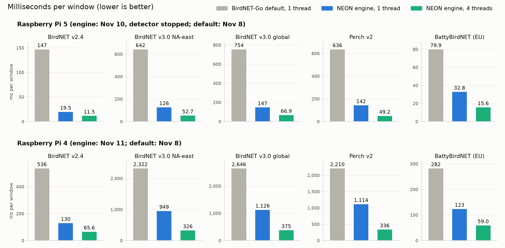

# Measured speed

*The figure compares BirdNET-Go's default model file at one thread with the engine at one and four threads.
BirdNET-Go itself runs ONNX Runtime on as many threads as the CPU has cores (4 on a Pi). Like for like at 4 threads,
the default takes 68.5 ms (Pi 5) / 204.7 ms (Pi 4) for BirdNET v2.4 against the engine's 11.5 / 65.6 ms, and
337.7 / 885.8 ms for BirdNET v3.0 north-america-east against 52.7 / 325.6 ms.*

Median milliseconds per window, pinned to cores on Linux (a Mac cannot pin, so its timings are only relative). The
engine rows on the Pi 5 are from one session with BirdNET-Go's detector stopped (2026-11-10), on the Pi 4 from one
session on an idle board (2026-11-11); both tables, with CPU time and peak memory per thread count, are in
[`results/timing/`](../results/timing).

The stock column was measured at one thread in earlier sessions on the same boards (2026-11-08,
[`results/COMPARISON.md`](../results/COMPARISON.md)). "Default" there is the model file BirdNET-Go `main` (5dca544a4)
selects for that model on that board, run by Python ONNX Runtime 1.31.1 (CPU execution provider, one intra-op thread)
in a timing harness, not inside the BirdNET-Go process. "TFLite" is the official BirdNET v2.4 TFLite FP32 file
through the TFLite C API 2.17.1 with XNNPACK, the runtime BirdNET-Go links. Files marked "not hosted" are this
project's own conversions, which neither BirdNET-Go nor this repository publishes.

| model | engine file | Pi 5 ms, 1 / 4 threads | Pi 4 ms, 1 / 4 threads | stock options, same board, 1 thread (ms) |
|---|---|---|---|---|
| BirdNET v2.4 (6,522 classes) | `neon-fp16` package / `.bn24` mode 0 | 19.5 / 11.5 | - (no fp16) | Pi 5: default (`BirdNET_INT8_ARM.onnx`) 146.8; upstream's Hugging Face `fp32_foldconv` 58.7; TFLite FP32 78.0 |
| BirdNET v2.4 | `neon-fp32` package / `.bn24` mode 2 | 36.5 † | 129.5 / 65.6 | Pi 4: default (`BirdNET_INT8_ARM.onnx`) 536.0; `fp32_foldconv` 213.7; TFLite FP32 237.5 |
| BirdNET v3.0 north-america-east (800) | `neon-fp16` package | 126.4 / 52.7 | - (no fp16 / dotprod) | Pi 5: default (ORT fp32) 642.3 |
| BirdNET v3.0 north-america-east | `neon-int8` package | ~361 † | 949.3 / 325.6 | Pi 4: default (ORT fp32) 2,321.8; TFLite int8 (not hosted, delegate flag QS8 off) 1,401.0 |
| BirdNET v3.0 north-america-east | `neon-fp32` package | ~344 † | 1,234 / 440 † | - |
| BirdNET v3.0 global (11,560) | `neon-fp16` package | 146.9 / 66.9 | - (no fp16 / dotprod) | Pi 5: default (ORT fp32) 754.3 |
| BirdNET v3.0 global | `neon-int8` package | ~426 † | 1,125.8 / 375.4 | Pi 4: default (ORT fp32) 2,646.0 |
| BirdNET v3.0 global | `neon-fp32` package | ~420 † | 1,532 / 616 † | - |
| Perch v2 (14,795) | `neon-fp16-s8` (fp16, int8 head) | 142.0 / 49.2 | - | Pi 5: default (ORT fp32) 635.9 |
| Perch v2 | `neon-fp16` / `neon-fp32` | 231.5 / 454.3 † | - / 1,950 † | Pi 4: fused int8-head ONNX (not hosted) 1,599.9 |
| Perch v2 | `neon-int8` package (fp32, int8 head) | not timed | 1,113.8 / 336.1 | Pi 4: default (ORT fp32) 2,210.4 |
| Perch v2 north-america-east slice (999) | `s8` / `fp16` / `fp32` | 68.0 / 73.7 / 151.7 † | - / - / 567 † | - |
| BattyBirdNET (per region; EU timed) | `neon-fp32` | 32.8 / 15.6 | 123.3 / 59.0 | Pi 5: default 79.9 (fused ONNX, not hosted: 58.8); Pi 4: default 282.1 |

At 4 threads, the number BirdNET-Go uses on a Pi, the stock default takes 68.5 ms (Pi 5) / 204.7 ms (Pi 4) for
BirdNET v2.4 and 337.7 / 885.8 ms for BirdNET v3.0 north-america-east (ONNX Runtime's default spinning on, as in
BirdNET-Go); the other defaults were not timed at 4 threads.

Rows marked † are from earlier sessions of 2026-11-04 to 2026-11-09 ([`results/MENU.txt`](../results/MENU.txt), and
`results/compare/` for the v2.4 `neon-fp32` row on the Pi 5 and the Perch fp32 rows on the Pi 4), at one thread
except the second Pi 4 value of the v3.0 `neon-fp32` rows; in the two Perch rows that name several files, the values
are per file (`neon-fp16` / `neon-fp32`, `s8` / `fp16` / `fp32`) at one thread. Pi 4 rows on an idle board; Pi 5 rows with BirdNET-Go's detector stopped, except the
v3.0 `neon-int8` / `neon-fp32` values marked ~, which were timed with it running and are rough. The figure and the
stock column therefore compare a 2026-11-08 default with later engine sessions; the engine's own rows from the
2026-11-08 sessions (v2.4, Perch, bats) agree with these within about 2 % (`results/COMPARISON.md`).

Each engine row passed its accuracy gate against the fp32 reference ([docs/GATES.md](GATES.md); result files in
`results/`). The bird gates replay BirdNET-Go's detection post-processing on recordings from the northeastern US,
which exercises the 65 annotated species in them; every other class is checked by window-level agreement only. The
bat gate is window agreement on its own recording set.

Peak memory (RSS): BirdNET v2.4 packages 42 MB (`neon-fp16`, Pi 5) and 66-67 MB (`neon-fp32`, Pi 4); the legacy
`.bn24` engine 119 MB. BirdNET v3.0 `neon-fp16` packages on the Pi 5: NA-east 81 MB (91 MB at 4 threads), global
336 MB (the retired `.bnv3` engine: 137 MB NA-east; ORT global: 745 MB). v3.0 packages on the Pi 4: NA-east int8
78-81 MB / fp32 163 MB, global int8 179-182 MB / fp32 564 MB. Perch v2 137 MB (`s8`) to 427 MB (`fp32`), 158-160 MB for
the `neon-int8` package on the Pi 4. BattyBirdNET 40-42 MB. The BattyBirdNET `neon-fp16` package failed its gate, so
the bats ship as `neon-fp32` only.

Gate results: v2.4 `results/gate_A017_result.txt` (fp16) and `gate_A019_result.txt` (fp32); v3.0 packages
`gate_K2B_G1_*_result.txt` (`neon-fp16`) and `gate_V002_*_result.txt` (`neon-int8`, `neon-fp32`); Perch
`gate_N012`-`N014` (full), `gate_K110` (the `neon-int8` package) and `gate_N016`-`N018` (slice); BattyBirdNET: the bat
gate, summarized in `MENU.txt`. On the Pi 4, full Perch v2 runs as the `neon-int8` package (an int8 prototype head
without dotprod); a regional slice is faster still. The BirdNET v3.0 `neon-int8` / `neon-fp32` packages' Pi 5 times
are rough.

Threads, ms per window at 1 / 2 / 3 / 4 threads. Pi 5: v2.4 19.5 / 14.3 / 12.1 / 11.5; v3.0 NA-east 126.4 / 74.5 /
58.7 / 52.7; v3.0 global 146.9 / 87.6 / 72.2 / 66.9; Perch v2 142.0 / 79.3 / 59.5 / 49.2; BattyBirdNET 32.8 / 20.7 /
17.1 / 15.6. Pi 4: v2.4 129.5 / 86.1 / 72.9 / 65.6; v3.0 NA-east 949.3 / 521.2 / 383.1 / 325.6; v3.0 global 1,125.8 /
609.7 / 446.0 / 375.4; Perch v2 1,113.8 / 588.8 / 418.4 / 336.1; BattyBirdNET 123.3 / 79.8 / 66.0 / 59.0. Outputs were
bit-identical at every thread count, by hash over the timing inputs (16 to 32 windows per model, 1 to 4 threads, on
both boards); total CPU time per window rises at 4 threads, by 21 % (Perch) to 55 % (v3.0
global) on the Pi 5 and by 15 % (Perch) to 37 % (BattyBirdNET) on the Pi 4, so one thread is the most efficient
setting. Timings from a Mac or a container are not a Pi's timings.
