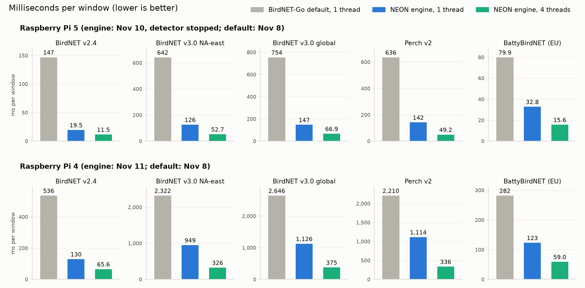

# Speed comparison on BirdNET-Go: stock default, upstream options, TFLite + XNNPACK, fused ONNX files, NEON engine

The stock and runtime options were measured on 2026-11-08 against upstream BirdNET-Go `main` at 5dca544a4
(2026-11-08): one session per board, the same board and day, 1 thread pinned to one core, a fresh process per option,
and 3 interleaved repetitions (the reported value is the median of the three per-repetition medians). Experiments
C001 (Pi 4), C002 (x86) and C003 (Pi 5); the raw rows are in `results/compare/`. The TFLite + XNNPACK rows come from
a second session per board on the same day (C007 Pi 4, C008 Pi 5), each with the stock defaults re-measured in it;
their speed-ups use those same-session defaults, which agree with C001 / C003 within 1.7 %. On x86 the whole option
set was re-run with the TFLite rows (C006), and every x86 number below is from C006.

The NEON engine rows are from later sessions with the engine's current packages: the Pi 5 on 2026-11-10 with
BirdNET-Go's detector stopped (`results/timing/pi5_detector_stopped.txt`), the Pi 4 on 2026-11-11
(`results/timing/pi4.txt`). The stock default was not re-measured in those sessions, so the speed-ups of engine rows
divide a 2026-11-08 default (1 thread) by a later engine time (1 thread unless stated).

"Default" means the model file BirdNET-Go `main` selects for that model on that board, run by Python ONNX Runtime
1.31.1 (CPU execution provider, graph optimization ALL, batch 1, 1 intra-op thread) in a timing harness, not inside
the BirdNET-Go process; the x86 BirdNET v2.4 default is the embedded TFLite file, run through the TFLite C API 2.17.1
with XNNPACK. BirdNET-Go itself sets ONNX Runtime to as many threads as the CPU has cores (4 on a Pi).

The figure (made by `scripts/plot_final_perf.py`) compares one thread of the default with one and four threads of the
engine. Like for like at 4 threads, the default takes 68.5 ms (Pi 5) and 204.7 ms (Pi 4) for BirdNET v2.4 and 337.7 /
885.8 ms for BirdNET v3.0 north-america-east, against the engine's 11.5 / 65.6 ms and 52.7 / 325.6 ms (tables below).
The other models' defaults were not timed at 4 threads.

## Summary

Three tiers, each measured against BirdNET-Go's default on the same board (1 thread):

> **1. Model-file swap, stock ONNX Runtime.** A fused v2.4 file (this project's `BirdNET_v2.4_fp32_fused.onnx`, not
> hosted) runs **2.5×**
> faster than the arm64 default on a Pi 5 (146.8 → 58.9 ms) and a Pi 4 (536 → 214 ms), and **1.9×** faster than the
> TFLite default on x86 (51.8 → 27.5 ms), with detections identical to TFLite (0 flips / 227,022 windows). Upstream's
> HF `fp32_foldconv` is the same file in effect: the same speed (58.7 / 213.7 / 26.9 ms) and the same gate result.
> For v3.0 and Perch this tier gives 1.1-1.8× (the v3.0 FFT front end is an exact rewrite, 0 flips; the Perch
> int8-head file passes its gate).
>
> **2. TFLite + XNNPACK (the runtime is already in BirdNET-Go: libtensorflowlite_c 2.17.1 with the XNNPACK delegate,
> the x86 v2.4 default).**
> - **v2.4, no conversion:** the official TFLite FP32 file (BirdNET-Go's own accuracy reference, so no gate is
>   needed) is **1.9×** faster than the arm64 default on a Pi 5 (146.2 → 78.0 ms) and **2.2×** on a Pi 4 (526.8 →
>   237.5 ms). It is slower than the fused ONNX file (58.9 / 214 ms). On arm64, BirdNET-Go remaps v2.4 to
>   `BirdNET_INT8_ARM.onnx`, and the container images are built without the embedded TFLite file, so for arm64 it is
>   one more file (52 MB) to host or download.
> - **v3.0, per-row dynamic int8 TFLite files:** NA-east (gated: F6 PASS on an x86 LiteRT build, ARM spot check
>   F025) is **2.4×** faster on a Pi 5 (644 → 271 ms) and **1.7×** on a Pi 4 (2,334 → 1,401 ms). Global, built with
>   the same recipe, is **2.4×** on a Pi 5 (750 → 316 ms) and **1.7×** on a Pi 4 (2,675 → 1,584 ms) but **fails its
>   gate** (C012, the G003 criterion) on one item: one window flips at 0.84 with a margin of 0.074, above the 0.05
>   limit (a Black-throated Green Warbler, 0.766 → 0.842). Its detection replay matches fp32 in totals (174/5/156;
>   dP / dR pass). On the Pi 4, TFLite 2.17.1 crashes at the first invoke on both int8 files at its
>   default delegate flags (a null function pointer inside the library); the Pi 4 numbers are with the delegate's
>   `QS8` flag cleared, which avoids it and which BirdNET-Go cannot set today. No gain on x86 (0.9-1.0×).
> - **Availability:** BirdNET-Go `main` (5dca544a4) has no TFLite route for BirdNET v3.0 (it loads v3.0 through ONNX
>   Runtime or, opt-in, OpenVINO), so these files need a BirdNET-Go code change (not published) and a hosted file per model; go-tflite exposes no delegate flags,
>   and the Pi 4 needs QS8 off. As built, the int8 files still carry the unused fp32 copies of the quantized filters;
>   dropping those unreferenced buffers takes NA-east from 157 to 62 MB and global from 667 to 165 MB, with outputs
>   bit-identical on 79 windows.
> - **No gain for Perch v2 or the bats:** Perch FP32 TFLite 0.9× on both Pis and 0.5× on x86, though it passes the
>   Perch gate (C013: identical detections); BattyBirdNET 1.0× / 1.2× / 0.8×, and it fails the bat gate vs the stock
>   ONNX (C014; the original BattyBirdNET-Analyzer pipeline fails it the same way).
>
> **3. NEON engine + optimizations (a separate C library; the largest gains on ARM).** On a Pi 5 at 1 thread, v2.4
> takes **19.5 ms**: **7.5×** faster than the default, **3.0×** faster than upstream's best file and **4.0×** faster
> than TFLite FP32 + XNNPACK. v3.0 NA-east is **5.1×** (642 → 126 ms; 2.1× the TFLite int8 file), v3.0 global
> **5.1×** (754 → 147 ms; peak RSS 745 → 336 MB, a Python ORT process vs the C CLI), and Perch v2 **4.5×** (636 → 142
> ms, vs the catalog fp32 default; 2.8× vs the aarch64 int8-arm selection, which fails the gate). Every one is gated.
> On a Pi 4, v2.4 is **4.1×** (536 → 130 ms; 1.8× the TFLite FP32 file), and BirdNET v3.0 runs there as compiled int8
> packages: NA-east **2.4×** (2,322 → 949 ms; 326 ms at 4 threads) and global **2.4×** (2,646 → 1,126 ms; 375 ms at
> 4 threads), both gated (V002) and 1.4-1.5× the TFLite int8 files at 1 thread. Perch v2 on a Pi 4 is **2.0×**
> (2,210 → 1,114 ms; 336 ms at 4 threads) as a package with an int8 prototype head, gated (K110) and 1.4× the fused
> int8-head file.

Caveats, in short:
- **Sessions.** The engine rows are from 2026-11-10 (Pi 5) and 2026-11-11 (Pi 4), the defaults from 2026-11-08
  (above). The engine's v2.4, Perch and bat rows of the 2026-11-08 sessions (in `results/compare/`) agree with
  them within 2.1 %; the v3.0 engine rows there are the retired hand-written `.bnv3` engine.
- **Where NEON doesn't apply.** The NEON engine has no x86 path; there, only the file swap helps. On a Pi 4
  (Cortex-A72, no fp16 arithmetic or dotprod) BirdNET v3.0 and Perch v2 run as compiled `neon-int8` packages.
- **Perch on a Pi 4.** The full Perch v2 model runs **2.0×** faster than the default there as a compiled package with
  an int8 prototype head for CPUs without dotprod (gated, K110: 4/4 configurations). The fused int8-head file gives
  1.4× (1,600 ms) on stock ONNX Runtime. The package's fp32 path alone is 1.1× (1,950 ms): on the A72 the prototype
  head is 77 % of that window. A regional slice is faster still: 567 ms (fp32 path) against 1,040 ms for upstream's
  regional tile.
- **Threads.** BirdNET-Go's default thread count is the number of cores (4 on a Pi). At 4 threads (wall clock) the stock INT8_ARM file takes
  68.5 ms and `fp32_foldconv` 33.8 ms on the Pi 5; the engine takes 11.5 ms at 4 threads and 19.5 ms at 1. The
  engine's outputs are bit-identical at every thread count, but total CPU time per window rises with threads (by
  21-55 % at 4 threads on the Pi 5 and 15-37 % on the Pi 4), so one thread is the most efficient setting.
- **TFLite threads.** BirdNET-Go gives the XNNPACK delegate threads − 1 threads and the interpreter 1 thread. The
  int8 files' dynamically quantized layers then run on TFLite's own kernels on one thread, so they barely scale: v3.0
  NA-east takes 214 ms at BirdNET-Go's 4-thread setting on a Pi 5 (271 ms at 1 thread), where ORT fp32 at 4 threads
  takes 338 ms. On a Pi 4 it takes 1,308 ms, where ORT fp32 at 4 threads takes 886 ms. Table below.

Legend for the tables: **ms** = median ms per window at 1 thread; **RSS** = peak RSS in MB (Pi 5 / Pi 4 / x86).
ORT/OpenVINO RSS is the peak of a Python process (interpreter + numpy + runtime), while NEON and TFLite (C API) RSS
is the C harness's VmHWM, so the two are not strictly like-for-like; neither is the BirdNET-Go process. **Reference** = the stock model
the gate compares against. **"not gated"** = no accuracy verdict exists for that option; it does not imply parity.

## BirdNET v2.4 (3 s window, 6,522 classes)

Reference: official TFLite FP32 (BirdNET-Go's non-arm64 default); calibration reference: the shipped ONNX fp32.
Gate: 34.4 h, 227,022 windows, three BirdNET-Go configurations (upstream default 0/0.8/L0, Pi template
2.2/0.8/L2, C4 1.5/0.8/L2), with a paired bootstrap over 37 periods.

| option | Pi 5 ms | Pi 4 ms | x86 ms | RSS MB | accuracy vs reference | ships today? |
|---|---:|---:|---:|---|---|---|
| **Stock default, arm64**: `BirdNET_INT8_ARM.onnx`, ORT | **146.8** | **536.0** | 65.6 | 156 / 156 / 175 | no full gate (round-1 screen: same decisions as int8-arm-dfttrunc) | yes, the arm64 default |
| **Stock default, amd64**: embedded TFLite FP32 (XNNPACK); C API 2.17.1 / LiteRT 2.3 Python | - | - | **51.8** / 50.7 | - / - / 149 (C) | the reference | yes, the amd64 default |
| Upstream gallery `int8-arm-dfttrunc`, ORT | 79.2 | 276.9 | - | 144 / 145 / - | FAIL at the upstream default vs TFLite (-2 TP, dR -0.62 pp [-1.47, 0]); PASS at the Pi template and C4; PASS vs the shipped ONNX | yes, gallery opt-in (aarch64) |
| Upstream gallery `fp32-dfttrunc`, ORT | 82.2 | 299.7 | 42.1 | 163 / 162 / 197 | not re-gated; upstream says bit-exact to the fp32 ONNX, which passes the declared rule vs TFLite (1 TP short at the upstream default, dR -0.31 pp [-1.06, 0], CI includes 0; the v3-strict rule marks that configuration FAIL, the other two PASS; 47 flips, max margin 0.038) | yes, gallery opt-in |
| Upstream HF `int8_arm_foldconv`, ORT (HF selection for aarch64) | 58.0 | **209.6** | - | 124 / 125 / - | C005: FAIL at the upstream default and C4 vs TFLite (-2 TP, dR -0.61 pp [-1.39, 0]); PASS at the Pi template; 357 flips, all margins ≤ 0.012. At C4: -2 TP, dR -0.60 pp [-1.55, 0]. vs the shipped ONNX: FAIL at C4. The same verdict as this project's `int8_arm_fused` file (F/P/F, 357 flips); one configuration worse than today's int8-arm-dfttrunc (F/P/P vs TFLite, 367 flips; PASS vs the shipped ONNX) | HF only (2026-11-07); not in the catalog |
| Upstream HF `fp32_foldconv`, ORT (HF selection for A76 and x86) | **58.7** | 213.7 | **26.9** | 161 / 160 / 193 | **PASS, 0 flips vs TFLite** (C004; 87.9 dB) | HF only (2026-11-06); not in the catalog |
| Upstream opt-in OpenVINO f32 (`backend: openvino`), `fp32-dfttrunc` | 86.2 | - | 32.9 | 275 / - / 254 | not gated | yes, explicit opt-in (auto declines it on arm64) |
| Upstream opt-in OpenVINO f32, `fp32_foldconv` | 78.5 | - | 27.7 | 270 / - / 244 | not gated | HF file + explicit opt-in |
| **TFLite FP32 + XNNPACK**, official file (`BirdNET_GLOBAL_6K_V2.4_Model_FP32.tflite`), C API 2.17.1 (C008 / C007 / C006) | **78.0** (146.2) | **237.5** (526.8) | = the amd64 default | 147 / 147 / 149 | **the reference itself** | the runtime ships; on arm64 the default is remapped to INT8_ARM ONNX (`model_registry.go:331-358`) and the container images are built with `noembed` (the arm64 image of release 20261014 holds only the ONNX file) |
| TFLite FP16 + XNNPACK, official file (Zenodo 15050749 `audio-model-fp16.tflite`) | 78.4 | 238.8 | 50.9 | 261 / 262 / 263 | **PASS** C009 vs both references, all 3 configurations (120 flips, all margins ≤ 0.0035; 52.2 dB) | no (not in BirdNET-Go); no speed gain over FP32 |
| TFLite INT8 + XNNPACK, official file (Zenodo 15050749 `audio-model-int8.tflite`) | 67.5 | 228.6 | 51.3 | 127 / 127 / 129 | **FAIL** C010, all 3 configurations (22.2 dB; 6,460 flips, 2,186 with margin > 0.05; Pi template -10 TP, dR -3.09 pp [-5.84, -1.11]) | no |
| **Fused fp32 ONNX** (this project's `BirdNET_v2.4_fp32_fused.onnx`, not hosted), stock ORT | 58.9 | 214.4 | **27.5** | 161 / 160 / 193 | **PASS, 0 flips vs TFLite** (86.3 dB); PASS vs ONNX | no: not hosted, not in the catalog; equivalent to upstream's `fp32_foldconv` |
| **NEON engine + optimizations, fp16 path** (A76; 2026-11-10 session) | **19.5** (4 threads: 11.5) | - | - | 42 / - / - | **PASS** A017 (163 flips, all margins ≤ 0.0044; 54.3 dB) | no: needs a BirdNET-Go build with the engine binding (not published); package not hosted |
| **NEON engine + optimizations, fp32 path** (any AArch64; Pi 5: C003, Pi 4: 2026-11-11 session) | 36.5 | **129.5** (4 threads: 65.6) | - | 93 / 66 / - | **PASS, 0 flips** A019 (80.6 dB) | no: as above |
| Context, 4 threads (wall clock; ORT spinning on / off): stock INT8_ARM | 68.5 / 69.7 | 204.7 / 226.3 | - | 151 / 156 / - (spinning on; off: 154 / 156) | - | 4 threads = BirdNET-Go's default on a Pi |
| Context, 4 threads (spinning on / off): best upstream file (Pi 5 `fp32_foldconv`, Pi 4 `int8_arm_foldconv`) | 33.8 / 34.7 | 94.5 / 98.6 | - | 159 / 124 / - (spinning on; off: 161 / 124) | - | HF only |
| Context, TFLite FP32 + XNNPACK at 2 / 3 / 4 delegate threads (3 = BirdNET-Go's 4-thread setting); same session: stock INT8_ARM at 4 threads | 67.1 / 62.9 / 65.5; ORT 63.7 | 190.2 / 182.2 / 175.8; ORT 201.1 | - | 147 / 147 / - | - | - |

Values in parentheses are the stock default re-measured in the TFLite session; the TFLite speed-ups use them. The
Pi 4 TFLite rows come from two sessions (A and B, see Method), each with its own re-measured default.

Speed-ups. **Pi 5:** NEON fp16 is 7.5× the default and 3.0× upstream's best file. That file is `fp32_foldconv`:
HF's A76 selection, gate PASS. The faster-by-0.7 ms `int8_arm_foldconv` fails the gate at two of three
configurations. NEON fp16 is also 3.0× this project's fused file, which is 2.5× the default. **Pi 4:** NEON fp32 is 4.1× the
default and 1.6× upstream's best file (`int8_arm_foldconv`, HF's aarch64 selection; `fp32_foldconv` is 1.6× too).
The fused file is 2.5× the default. **x86:** the fused file is 1.9× the TFLite default, and so is upstream's
`fp32_foldconv`. **TFLite + XNNPACK:** the official FP32 file is 1.9× the arm64 default on the Pi 5 and 2.2× on the
Pi 4, with the reference's own detections; it is 1.3× slower than the fused file on the Pi 5 and 1.1× slower on the
Pi 4. The official FP16 file passes the gate but is no faster, and its peak RSS is 114 MB higher than FP32's (261 vs 147 MB), consistent with
the fp16 weights being expanded to fp32 at load. The
official INT8 file is 2.2× / 2.3× but fails the gate by a wide margin.

Upstream's `--fold-frontend` (the converter, since 2026-11-06) produced its HF `fp32_foldconv`. That file matches this
project's fused file on every board (within 3 %: 0.4 / 0.4 / 2.2 % on the Pi 5 / Pi 4 / x86) and on the gate: 0 flips vs TFLite on both,
with full-vector logit SQNR 87.9 dB for foldconv vs 86.3 dB for the fused file. The two files are equivalent: for v2.4 the
file-swap tier is available upstream already, as `fp32_foldconv` / `int8_arm_foldconv` on HF.

## BirdNET v3.0 NA-east regional slice (5 s window, 800 classes)

The regional fp32 slice is what BirdNET-Go picks for a North American location. Reference: fp32 ORT. Gate: v3
harness, 92,829 windows.

| option | Pi 5 ms | Pi 4 ms | x86 ms | RSS MB | accuracy vs reference | ships today? |
|---|---:|---:|---:|---|---|---|
| **Stock default**: `fp32@north-america-east`, ORT | **642.3** | **2,321.8** | **236.2** | 337 / 338 / 390 | the reference | yes |
| Upstream opt-in OpenVINO f32 (A76) | 768.5 | - | - | 589 / - / - | not gated | explicit opt-in only (slower) |
| **TFLite int8 + XNNPACK**: per-row dynamic int8 (`v3na_fft_i8dyn_s0se.tflite`, FFT front end), C API 2.17.1 | **271.4** (644.2) | **1,401.0** (2,334.3), QS8 off; default flags crash | 254.2 | 165 / 152 / 183 | **PASS** (F6, 34.4 h at the v3 gate's configuration: 171/4/159 = fp32; dP -0.00 [-0.04, +0.03], dR -0.01 [-0.86, +0.79]; x86 LiteRT build, Pi kernels not bit-identical, F025) | no: BirdNET-Go `main` does not load a v3.0 `.tflite` (needs a code change, not published); file not hosted; the Pi 4 also needs the delegate's QS8 flag off or a newer TFLite library |
| TFLite FP32 + XNNPACK (`v3na_fft_fp32.tflite`, exact port with an FFT front end) | 523.0 | 1,743.9 (2,297.9) | 247.5 | 299 / 298 / 301 | not gated (exact port: 76.6 dB, 0 flips on 63 windows, F002) | no: as above |
| Context, TFLite int8 at 2 / 3 / 4 delegate threads; same session: ORT fp32 at 4 threads (spinning on) | 227.3 / 213.8 / 229.7; ORT 337.7 | 1,317.6 / 1,308.4 / 1,308.4 (QS8 off); ORT 885.8 | - | 165 / 152 / - | - | 3 = BirdNET-Go's 4-thread setting |
| FFT front-end ONNX (`fft3`, this project's rewrite with a partial real FFT), stock ORT | 574.7 | 2,165.2 | 206.5 | 313 / 313 / 365 | exact rewrite: 0 flips / 92,829 windows, max dconf 5.3e-5 | no: file not hosted |
| **NEON engine + optimizations, `neon-fp16` package** (int8 dot products + fp16; `birdnet_v3.0_north-america-east-neon-fp16.bnpk`; 2026-11-10 session) | **126.4** (4 threads: 52.7) | n/a (needs fp16 + dotprod) | n/a | 81 / - / - | **PASS** K2B-G1 (172/5/158 vs fp32 171/5/159; dP +0.02 [-0.03, +0.10], dR +0.32 [-0.66, +1.37]; Jaccard 0.976, max flip margin 0.021, 50.8 dB) | no: needs a BirdNET-Go build with the engine binding (not published); package not hosted |
| **NEON engine + optimizations, `neon-int8` package** (any AArch64; `birdnet_v3.0_north-america-east-neon-int8.bnpk`; Pi 4: 2026-11-11 session) | (~361, rough; `neon-fp16` is the Pi 5 path) | **949.3** | n/a | - / 78 / - | **PASS** V002 (171/5/159 = fp32; dP -0.00 [-0.05, +0.04], dR +0.01 [-0.87, +0.83]; Jaccard 0.980, max flip margin 0.020, 53.0 dB) | no: needs a BirdNET-Go build with the engine binding (not published); package not hosted |
| NEON engine, `neon-fp32` package (any AArch64; K068 session, 2026-11-09) | - | 1,233.9 | n/a | - / 163 / - | **PASS** V002 (identical detections in every period, 99.0 dB) | no: as above |
| Context, NEON `neon-int8` package at 2 / 4 threads (2026-11-11; outputs identical to 1 thread) | - | 521.2 / 325.6 | - | - / 79-81 / - | - | BirdNET-Go runs packages with `birdnet.threads` |

Upstream has no faster CPU option for v3.0 (no int8; FP16 is "slower than FP32 and not a RAM saving" on CPU, per upstream's manifest; OpenVINO f32 is slower on the
A76). Speed-ups on the Pi 5: NEON 5.1×; TFLite int8 2.4×; fft3 1.1×. Pi 4: TFLite int8 1.7× with the QS8 path off
(at the default flags 0x3, TFLite 2.17.1 segfaults on the A72 at the first invoke: a null function pointer inside the
library, the same with 2 / 3 / 4 threads and with the ENABLE_LATEST_OPERATORS flag; it runs with QS8 off or without
the delegate; LiteRT 2.3 from Python runs the same file at its defaults in 1,332.6 ms). x86: TFLite int8 0.9×. Pi 4: the `neon-fp16` package needs
fp16 + dotprod, but the `neon-int8` package runs there: **2.4×** the default at 1 thread (2,321.8 → 949.3 ms; 1.5×
the TFLite int8 file with QS8 off) and 326 ms at 4 threads, 2.7× ORT fp32 at 4 threads (885.8 ms) and 4.0× TFLite
int8 at BirdNET-Go's 4-thread setting (1,308.4 ms). The engine rows come from later sessions (see the top), not from
C001 / C003.

## BirdNET v3.0 global (5 s window, 11,560 classes)

| option | Pi 5 ms | Pi 4 ms | x86 ms | RSS MB | accuracy vs reference | ships today? |
|---|---:|---:|---:|---|---|---|
| **Stock default**: global `fp32`, ORT | **754.3** | **2,646.0** | **285.6** | 745 / 748 / 798 | the reference | yes (catalog default; MinRAMMB 800) |
| Upstream opt-in OpenVINO f32 (A76) | 857.4 | - | - | 1,374 / - / - | not gated | explicit opt-in only (slower, +629 MB) |
| Upstream's own speed advice: use the regional slice | (642.3) | (2,321.8) | (236.2) | (337 / 338 / 390) | identical on the kept species (per upstream) | yes, but a different class set (see the NA-east table) |
| **TFLite int8 + XNNPACK**: per-row dynamic int8 (`v3g_fft_i8dyn_s0se.tflite`, the NA-east recipe unchanged; built C012), C API 2.17.1 | **316.2** (750.5) | **1,583.5** (2,674.9), QS8 off; default flags crash | 293.0 | 362 / 263 / 377 | **FAIL** C012 on (d) alone: 1 flip at 0.84 with margin > 0.05 (0.074; fp32 0.766 → 0.842, Black-throated Green Warbler); replay 174/5/156 = fp32, dP -0.00 [-0.05, +0.04], dR +0.01 [-0.87, +0.83]; Jaccard 0.9766, top-1 0.9755, 59.2 dB; C API on the Mac | no: as for NA-east (BirdNET-Go `main` does not load a v3.0 `.tflite`); file not hosted |
| TFLite FP32 + XNNPACK (`v3g_fft_fp32.tflite`, exact port; built C011) | 618.0 | 2,022.0 | 323.3 | 1,054 / 1,076 / 1,079 | not gated: window check on 4 of 32 streams (8,313 windows: 0 flips, max dconf 1e-4, 108 dB; C011) | no: as above |
| FFT front-end ONNX (`fft3`, this project's rewrite), stock ORT | 690.2 | 2,316.9 | 254.8 | 732 / 734 / 784 | exact rewrite: 0 flips at 0.84 / 92,829 windows, 132.6 dB | no: file not hosted |
| **NEON engine + optimizations, `neon-fp16` package** (int8 dot products + fp16; `birdnet_v3.0-neon-fp16.bnpk`; 2026-11-10 session) | **146.9** (4 threads: 66.9) | n/a (needs fp16 + dotprod) | n/a | 336 / - / - | **PASS** K2B-G1 (175/5/155 vs fp32 174/5/156; dP +0.02 [-0.03, +0.09], dR +0.32 [-0.66, +1.37]; over 11,560 classes Jaccard 0.976, max flip margin 0.021, top-1 0.975, 58.9 dB) | no: needs a BirdNET-Go build with the engine binding (not published); package not hosted |
| **NEON engine + optimizations, `neon-int8` package** (any AArch64; `birdnet_v3.0-neon-int8.bnpk`; Pi 4: 2026-11-11 session) | (~426, rough; `neon-fp16` is the Pi 5 path) | **1,125.8** | n/a | - / 179 / - | **PASS** V002 (174/5/156 = fp32; dP -0.00 [-0.05, +0.04], dR +0.01 [-0.87, +0.83]; over 11,560 classes Jaccard 0.980, max flip margin 0.020, top-1 0.981, 61.2 dB) | no: needs a BirdNET-Go build with the engine binding (not published); package not hosted |
| NEON engine, `neon-fp32` package (any AArch64; K068 session, 2026-11-09) | - | 1,532.0 | n/a | - / 564 / - | **PASS** V002 (identical detections in every period, 106.3 dB) | no: as above |
| Context, NEON `neon-int8` package at 2 / 4 threads (2026-11-11; outputs identical to 1 thread) | - | 609.7 / 375.4 | - | - / 180-182 / - | - | BirdNET-Go runs packages with `birdnet.threads` |

Speed-ups on the Pi 5: NEON 5.1× with peak RSS 745 → 336 MB; TFLite int8 2.4× with 362 MB (fails C012 on one flip); fft3 1.1×. Pi 4: TFLite
int8 1.7× (QS8 off, as for NA-east); the NEON `neon-int8` package 2.4× (2,646.0 → 1,125.8 ms, peak RSS 179 MB) and
375 ms at 4 threads. x86: TFLite int8 1.0×. The TFLite FP32 port needs about 1.05 GB (XNNPACK packs
its own copy of the weights), which leaves little room on a 2 GB Pi. The retired hand-written engine took 150.2 ms
for the global model in C003 (peak RSS 395 MB); the `neon-fp16` package reproduces its numbers from the front end's
image onwards.

## Perch v2 (5 s window, 14,795 classes)

Reference: `perch_v2_fp32.onnx` (with the ONNX DFT op). Gate: 34.4 h, 142,293 windows, four configurations.

| option | Pi 5 ms | Pi 4 ms | x86 ms | RSS MB | accuracy vs reference | ships today? |
|---|---:|---:|---:|---|---|---|
| **Stock default**: catalog `fp32`, ORT | **635.9** | **2,210.4** | **291.3** | 855 / 858 / 871 | the reference | yes (catalog default) |
| Upstream aarch64 selection `int8-arm`, ORT | 396.0 | 2,047.4 | - | 340 / 339 / - | **FAIL** 4/4 configurations on Pi kernels (recall 33.6 → 27.3 % at the upstream default, 16.1 dB) | yes (manifest aarch64/onnxruntime) |
| Upstream x86 / OpenVINO selection `no-dft-fp32`, ORT | - | - | 287.5 | - / - / 875 | PASS (identical detections, 88.1 dB) | yes |
| Upstream opt-in OpenVINO f16 on the A76, `no-dft-fp32` | 778.9 | - | - | 998 / - / - | not gated | explicit opt-in only (slower) |
| TFLite FP32 + XNNPACK (`perch_v2_fp32.tflite`, converted from `no-dft-fp32`; built C013) | 692.2 (636.2) | 2,367.7 (2,205.4) | 541.6 | 854 / 854 / 857 | **PASS** C013, 4/4 configurations (identical detections; 0 flips at 0.5 / 0.8, max dconf 0.0009, 88.1 dB; C API on the Mac) | no: BirdNET-Go's Perch route is ONNX only |
| Fused fp32 ONNX (this project's, not hosted), stock ORT | - | - | 250.1 | - / - / 888 | PASS (identical detections, 113.6 dB) | no: not hosted, not in the catalog |
| Fused int8-head ONNX (this project's `fused_int8_arm`, not hosted), stock ORT | 359.0 | **1,599.9** | **233.9** | 337 / 342 / 363 | **PASS** 4/4 on Pi kernels (dP/dR 0.00 [0, 0], 54.0 dB) | no: as above |
| **NEON engine + optimizations, fp16 + int8 head** (A76; 2026-11-10 session) | **142.0** (4 threads: 49.2) | - | - | 137 / - / - | **PASS** N012 4/4 (51.8 dB, top-1 0.9955) | no: needs a BirdNET-Go build with the engine binding (not published); package not hosted |
| **NEON engine + optimizations, fp32** (any AArch64; C001) | - | 1,950.2 | - | - / 416 / - | **PASS** N014, 0 flips | no: as above |
| **NEON engine + optimizations, fp32 + int8 head** (any AArch64; `neon-int8` package) | - | **1,113.8** (4 threads: 336.1; 2026-11-11 session) | - | - / 158 / - | **PASS** K110 4/4 (53.1 dB, top-1 0.9962; 0 flips with margin > 0.05, max 0.0057 at 0.5) | no: as above |
| *Regional slice NA-east (999 classes); reference = full fp32 restricted to the slice* | | | | | | |
| Upstream low-RAM selection: regional `int8-arm` tile, ORT | 277.7 | 1,039.7 | - | 207 / 211 / - | **FAIL** (P021: top-1 0.674, 11.2 dB) | yes (manifest low-ram) |
| Fused regional int8 slice (this project's, not hosted), ORT | 247.9 | 867.8 | - | 203 / 207 / - | PASS (P021, 50.5 dB) | no |
| NEON slice, fp16 + int8 head / fp32 | 67.4 | 567.2 | - | 53 / 91 / - | PASS N017 / N016 | no |

Speed-ups. **Pi 5:** NEON 4.5× the default and 2.8× upstream's (gate-failing) int8-arm; fused int8-head 1.8×.
**Pi 4:** the full model is head-bound on the A72 (5.8 GMAC fp32 head). NEON fp32 is only 1.1× there, and the fused
int8-head file is better (1.4×). The Pi 4 route is the regional slice: NEON 567 ms against 1,040 ms for upstream's
tile (1.8×; that tile fails the gate). **x86:** fused int8-head 1.2×. **TFLite FP32** (C013 PASS, identical detections): 0.9× on both Pis and 0.5× on
x86. The swish activations come out of the converter as Neg/Exp/Add/Div; TFLite 2.17.1 does not delegate EXP, so 104
EXP nodes run on TFLite's own kernels between 110 XNNPACK partitions. They are not the main cost: in the Mac plan they
take 17.8 of 231 ms, and the 55 fully connected layers on XNNPACK (the DFT and mel matmuls and the head among them)
take 162 ms. The plan does not explain the x86 gap to ORT.

## BattyBirdNET, EU head (144,000 samples at 256 kHz, embeddings backbone + region head)

Reference R = the stock ONNX (`birdnet-v2.4-embeddings-fp32-dfttrunc.onnx`). Gate: 26,505 windows, 11 heads.

| option | Pi 5 ms | Pi 4 ms | x86 ms | RSS MB | accuracy vs reference | ships today? |
|---|---:|---:|---:|---|---|---|
| **Stock default**: dfttrunc embeddings + head, ORT | **79.9** | **282.1** | **42.3** | 155 / 156 / 194 | the reference | yes (the only option) |
| TFLite FP32 + XNNPACK: official BirdNET v2.4 FP32 file with the 1,024-d embedding exposed as a second output + BattyBirdNET's own EU head (`BattyBirdNET-EU-256kHz.tflite`, rdz-oss/BattyBirdNET-Analyzer 64c458f) | 80.2 (78.6) | 237.3 (280.1) | 51.5 | 143 / 143 / 145 | **FAIL** vs the stock ONNX (C014: G2 max dconf 0.31, 193 flips; G4 SouthWales dP -0.12 [-0.24, -0.02]); this is the original BattyBirdNET-Analyzer pipeline, and the bat gate's floor (stock ONNX vs LiteRT TFLite FP32) fails G2 and G4 the same way; against the LiteRT Python scores the C API passes (117 dB, 1 flip) | no: the bat route is ONNX only |
| Fused embeddings (this project's `fused_t1`, not hosted) + head, stock ORT | 58.8 | 220.7 | **26.9** | 148 / 149 / 187 | accepted as an exception to the declared G2 limit: L2 events identical on all 11 heads, G4 PASS; the declared G2 limit is exceeded on 151 zero-padded clips only (max dconf 0.046 > 0.03) | no: not hosted, not in the catalog |
| **NEON engine + optimizations, fp32** (Pi 5: 2026-11-10, Pi 4: 2026-11-11 sessions) | **32.8** (4 threads: 15.6) | **123.3** (4 threads: 59.0) | - | 41 / 40 / - | **PASS** 11/11 heads vs both references (docs/GATES.md) | no: needs a BirdNET-Go build with the engine binding (not published); package not hosted |

Upstream has no faster bat option: OpenVINO is declined on arm64, and the HF fp16/int8 bat files are not in the
catalog. Speed-ups: Pi 5 NEON 2.4×, fused 1.4×; Pi 4 NEON 2.3× (the stock backbone at 282 ms cannot keep up with
the 281 ms bat stride at 1 thread); x86 fused 1.6×. TFLite: 1.0× / 1.2× / 0.8×.

## Upstream speed recommendations today (5dca544a4 and the published model repositories)

Defaults and selection:
1. **v2.4 arm64 default = `BirdNET_INT8_ARM.onnx` on ORT**: `internal/classifier/model_registry.go:331-358`
   (remapV24ToONNXOnARM64), `internal/classifier/birdnet.go:754`. **amd64 default = embedded TFLite FP32 with
   XNNPACK**: `internal/classifier/models_embedded.go:14-15`, catalog `builtin` `model_catalog.go:463-472`,
   `internal/conf/defaults.go:85` (usexnnpack true).
2. **v2.4 gallery**: `fp32-dfttrunc` (Recommended on ORT CPU / OpenVINO CPU / CUDA) and `int8-arm-dfttrunc`
   (aarch64, ORT); `model_catalog.go:473-504`. The speed claim is "bit-exact ... about 1.4-2x faster" (`:418-420`).
3. **v2.4 foldconv on Hugging Face** (new; not in the catalog): `BirdNET_v2.4_fp32_foldconv.onnx` and
   `BirdNET_v2.4_int8_arm_foldconv.onnx`. huggingface.co/tphakala/BirdNET-v2.4 `models.json` `selection`
   (lines 17-23) picks fp32_foldconv for x86-64/onnxruntime, x86-64/openvino-cpu and aarch64-a76/onnxruntime, and
   int8_arm_foldconv for aarch64/onnxruntime. The README (lines 45-46, 72-77, 98-103) quotes 57.2 / 26.0 ms
   (1 / 4 threads; a second table on the same page gives 56.9 / 26.7) on a Pi 5 and 180.8 / 84.2 ms on a Pi 4 for fp32_foldconv, and 55.8 / 177.0 ms at 1 thread for
   int8_arm_foldconv.
4. **OpenVINO**: on auto, arm64 declines the OpenVINO CPU when ORT is present (`model_openvino.go:251-261`, #5069,
   2026-11-07). OpenVINO is forced to f32 for v2.4, v3.0 and bats on every device (`:202-210`; #5059). INT8 v2.4 files
   are declined on auto and run at f32 on an explicit opt-in (`:403-416`, with Pi 5 figures ORT 143 vs OpenVINO ~165 ms
   and 77 vs 87 ms). Wiki: `doc/wiki/openvino-acceleration.md:223-224` (f32 is 0.96-1.38x the ORT latency and uses
   +114-166 MB; "Raspberry Pi 4 ... Do not enable it").
5. **v3.0**: the catalog default is global `fp32` (MinRAMMB 800; `model_catalog.go:258-287`), with `fp16` for GPUs
   (`:288-316`). There are 43 regional fp32/fp16 tiles (`model_catalog_regional_gen.go`, e.g. NA-east `:1101-1136`),
   and no int8. The manifest selection (`internal/classifier/gen/manifests/BirdNET-v3.0-Models.models.json:27-35`)
   is fp32 for every CPU; its selection_notes (`:36`) say "Regional models are the low-RAM choice ... latency 15-30%
   ... Prefer regional FP32 over global FP16 on memory-constrained CPU devices". The HF README's "OpenVINO is ~2.2x
   faster than ONNX Runtime on a Raspberry Pi 5" (BirdNET-v3.0-Models README line 75) and the catalog's own benchmark
   rows (`model_catalog.go:277-279`: rpi5 openvino-cpu 168 ms vs onnxruntime-cpu 363 ms, 4 threads) date from the
   f16 era (flagged at `:263-268`).
   Measured here at today's forced f32, OpenVINO is slower than ORT (768 vs 642 ms; 857 vs 754 ms).
6. **Perch v2**: the catalog default is `fp32` with the DFT op (`model_catalog.go:343-359`); `no-dft-fp32` for
   OpenVINO (`:360-375`); `int8-arm` for aarch64 (`:376-387`). The manifest selection
   (`internal/classifier/gen/manifests/Perch-v2-Models.models.json:17-24`) is no_dft_fp32 for x86 and OpenVINO,
   int8_arm for aarch64/onnxruntime, and the regional int8_arm tile for low RAM.
7. **Bats**: the dfttrunc embeddings + fp32 region heads only (`model_catalog.go:804-857`, `:553-565`); no variants.
8. **Threads**: the default is 0 = NumCPU for ORT (`internal/inference/onnx.go:61-70`); onnx.go sets only thread
   counts (no spinning option anywhere in the file), so ORT's default (spinning on) applies. The wiki FAQ suggests an explicit `birdnet.threads: 4` (`doc/wiki/faq.md:198`).
9. **Converter** (github.com/tphakala/birdnet-onnx-converter, README as of 2026-11-08): `--int8-arm` "is the
   recommended variant" (lines 19-27); FP16 for "RPi 5, Modern GPUs" (lines 13-18, 126-131);
   `--fold-frontend` (added 2026-11-06, commit d1418391a): "about 25% faster on CPU than the default DFT truncation,
   which it supersedes. Not bit-exact" (lines 98-101).

10. **TFLite**: libtensorflowlite_c **2.17.1** from github.com/tphakala/tflite_c (`Dockerfile` `TFLITE_VERSION=v2.17.1`,
   `Taskfile.yml` `TFLITE_VERSION: v2.17.1`), through go-tflite. `internal/inference/tflite/classifier.go:48-57`
   creates the XNNPACK delegate from `TfLiteXNNPackDelegateOptionsDefault()` with only `num_threads = max(1, threads - 1)`
   (default flags 0x3 = QS8 | QU8) and sets the interpreter to 1 thread. go-tflite's `DelegateOptions` exposes
   `NumThreads` only, so no delegate flag can be set from Go. Unchanged between 9642f74f3 and 5dca544a4.

**Changed between 9642f74f3 (2026-10-13) and 5dca544a4**: the foldconv v2.4 files on HF (2026-11-06/07; selected by HF models.json, not
yet in the catalog); arm64 auto now prefers ORT over the OpenVINO CPU (b30f38a75, #5069); v2.4 on OpenVINO is forced
to f32 everywhere (1d15e2652, #5059); Perch regional score calibration (a2e497df6, #5014); a new BSG-BAT model
(06830b6ca, #5066; out of scope here, no engine port); minimum ONNX Runtime 1.31 (0f0fc798d, #5038). The v2.4, v3.0
and Perch variant lists and file names in the catalog are unchanged.

## Method and conditions

- **TFLite + XNNPACK rows** (C006 x86, C007 Pi 4, C008 Pi 5): `scripts/tfl_bench.c` linked against
  libtensorflowlite_c 2.17.1 from the tphakala/tflite_c release (the arm64 library is byte-identical to the one in
  BirdNET-Go's arm64 image, sha256 12062437...), set up as BirdNET-Go sets it up: the default delegate options with
  only the thread count set, interpreter threads 1. The model is loaded with `TfLiteModelCreateFromFile` (BirdNET-Go
  passes the bytes). Same windows as C001-C003 (the first 16 of each window set; 8 for the bats), the same runs and
  warm-ups, a fresh process per row, 3 interleaved repetitions, median of medians, peak RSS = VmHWM. The C API was
  used for every TFLite bar; the LiteRT 2.3 Python interpreter (the route of C002 and of the older-hardware runs
  H001-H005, `results/v3_older_hw/`) was run next to it as a check: v2.4 FP32 82.0 vs 78.0 ms (Pi 5), 239.8 vs 237.5 (Pi 4), 50.7 vs 51.8
  (x86); v3.0 NA-east int8 266.1 vs 271.4 (Pi 5), 252.3 vs 254.2 (x86). On the Pi 4 the int8 file runs only through
  Python at the default flags (1,332.6 ms, as H001's 1,333); the C API crashes there (above).
- **Same-session defaults.** The TFLite sessions re-ran each model's stock default. Against C001 / C003 they moved by
  -1.7 to +1.1 % (Pi 4) and -1.7 to +0.3 % (Pi 5), so C001 / C003 stay in the tables and the TFLite factors use the
  re-measured defaults (in parentheses). On x86 a partial session put the Perch default 4.3 % above C002, so the whole
  C002 option set was re-run with the TFLite rows (C006, 18:54-19:00 PST, load 0.7-1.3): every x86 cell is from C006,
  and its defaults sit within -0.9 to +2.4 % of C002.
- **Pi 5 (C008)**: the BirdNET-Go detector on the board was stopped for the session (21:52:15-22:03:02 EST) and started
  again afterwards; one bench at a time under a lock; MemAvailable 1.55-1.65 GB, 2400 MHz, 47-55 °C, detector
  "stopped" on every row (`compare/C008_pi5_session.log`).
- **Pi 4 (C007)**: two sessions under the bench lock (A 21:13-21:35 EST: v2.4, NA-east, bats, threads; B 21:51-22:12:
  global, Perch, the QS8-off rows); load 1.0-3.2 at the start of A (a venv install had just finished), 1.5 GHz.
- **Accuracy of the TFLite files**: v2.4 FP16 / INT8 gated with the v2.4 harness (C009 / C010), scored by the same C
  API on the Mac (arm64). v3.0 NA-east int8: the TFLite study's gate (F6, x86 LiteRT; ARM spot check F025).
  v3.0 global int8: the G003 criterion and harness (C012), C API on the Mac instead of the criterion's arm64 container
  build; a full rerun after a Mac reboot cut off the first run. Perch FP32: the Perch gate (C013), C API on the Mac,
  resumed after the same reboot (resume check in the result file). Bats: the bat gate on C-API embeddings (C014).
- **Pi 5** (C003, Raspberry Pi 5, Cortex-A76 2.4 GHz, 2 GB): the BirdNET-Go detector on the board was stopped for the
  session (18:55-19:12 EST) and started again afterwards. Load 1.04-1.58 on the 1-thread rows (1.0 is the benchmark
  itself; up to 1.74 on the 4-thread rows themselves), 2400 MHz throughout, 46-54 °C, MemAvailable 1.48-1.69 GB, and
  the detector was "stopped" on all 97 rows. Session log: `compare/C003_pi5_session.log`.
- **Pi 4** (C001, Raspberry Pi 4 Model B, Cortex-A72 1.5 GHz, 1.8 GB, idle test box): one bench at a time under a
  lock. Load 1.02-1.74 on the 1-thread rows (the first rows ran while the previous job's load average decayed; up to
  2.22 on the 4-thread rows themselves), 1500 MHz, 27-32 °C. The spread of the three repetitions is ≤ 2 % on 13 of
  25 rows (14 counting the Perch NEON row at 2.0 %). The worst: v3 NA-east fp32 10 % (rep 2 at 2,528 ms against
  2,290 / 2,322), fft3 6 %, v2.4 fused 5.6 % (rep 3 at 222.6 against 210.6 / 214.4), bats and the v2.4 int8 rows
  3.6-4.1 %; the medians are used.
- **x86** (C006, which replaces C002 in the tables; Xeon E5-2620 v4, AVX2, idle server, core 11): a venv with ORT
  1.31.1, OpenVINO 2026.2.0 and ai-edge-litert 2.3.0; TFLite through the C API (above). C002 had used the Python
  LiteRT interpreter for the TFLite default (50.3 ms; 50.7 in C006 against 51.8 through the C API).
- **Runtimes**: ONNX Runtime 1.31.1 (BirdNET-Go's minimum since #5038) and OpenVINO 2026.2.0 (the version upstream
  quotes), installed pinned (`pip install onnxruntime==1.31.1 openvino==2026.2.0`) in a fresh venv on each host (the
  x86 `pip list` is appended to its session log; the Pi venvs were removed with the other files), CPU EP, 1 intra-op thread, sequential, graph optimization ALL, batch 1. Harnesses: Python timing harnesses for ORT, the bats and
  OpenVINO (`INFERENCE_PRECISION_HINT` f32/f16, LATENCY hint; not in this repository), and the engine's
  `bench/cli.c` at commit f392f7d (mode 0 = the best path the CPU runs; Perch, bats and v2.4 as compiled `.bnpk`
  packages, v3 as `.bnv3` files of the retired engine). Windows: 16 real windows per model for ORT/OpenVINO (the dev sets, cycled; 30-50 timed
  runs for v2.4/bats, 10-15 for the 5 s models, after a warm-up) and 16-64 for the engine (1-5 passes). All inputs
  come from the same audio. The model files were checked by sha256 on each host (`compare/C00x_model_SHA256SUMS.txt`);
  the two foldconv files match the HF `SHA256SUMS` (c11781f7..., c2c63de3...).
- **NEON engine rows** (the current packages, `weights/SHA256SUMS`): Pi 5 on 2026-11-10 22:04-22:18 EST with the
  detector stopped, Pi 4 on 2026-11-11 16:30-17:05 EST; 7 repeats of every model at 1 / 2 / 3 / 4 threads, thread
  order rotated, throttled 0x0 on every row; median of the 7 repeats. Tables, CPU time per window and peak RSS:
  `timing/pi5_detector_stopped.txt`, `timing/pi4.txt`. The `neon-fp32` v3.0 package rows on the Pi 4 are from an
  earlier session (K068, 2026-11-09, 8 windows x 3 passes, outputs bit-identical to the gated candidates); the Pi 5
  `neon-fp32` v2.4 row and the Pi 4 Perch fp32 row are from C003 / C001. No stock default was re-run in those
  sessions, so the factors use C001's / C003's defaults.
- **Not like-for-like**: the RSS columns (see the legend); the 4-thread rows (wall clock, cores 0-3; context only;
  the spinning-on rows were added after repetition 1, so they are medians of 2 repetitions);
  OpenVINO rows (an opt-in path that BirdNET-Go's auto mode declines on arm64); upstream's regional slices next to
  full models.
- **Comparability with earlier numbers**: the rows of `MENU.txt` come from earlier sessions (2026-11-02/04, the Pi 5
  rows with BirdNET-Go running, ORT 1.25.1). None of those cells is mixed into the tables above. They agree with this
  run within ~2 % (Pi 5: INT8_ARM 146.9 vs 146.8, fused 59.2 vs 58.9, NEON 19.3 vs 19.5; Pi 4: 544.5 vs 536.0,
  212.9 vs 214.4, 131.0 vs 132.0 in C001).

## Sources

- Stock and runtime options: `compare/C001_pi4_*`, `compare/C002_x86_*`, `compare/C003_pi5_*` (option lists, per-run
  rows, session logs), `compare/C00x_summary.txt`, `comparison.csv`. The session scripts and raw per-run JSON are not
  in this repository.
- NEON engine rows: `timing/pi5_detector_stopped.txt`, `timing/pi4.txt`; figure `figures/final_perf.png`
  (`scripts/plot_final_perf.py`).
- TFLite + XNNPACK: `compare/C006_x86_*`, `compare/C007_pi4_*`, `compare/C008_pi5_*`, `compare/C006-C008_summary.txt`,
  `compare/C006-C008_SHA256SUMS.txt`; harness `scripts/tfl_bench.c`. Gates: `gate_C009_v24_tflite_fp16_result.txt`,
  `gate_C010_v24_tflite_int8_result.txt`, `gate_C011_v3g_tflite_fp32_windowcheck.txt`,
  `gate_C012_v3g_tflite_int8_result.txt`, `gate_C013_perch_tflite_fp32_result.txt`,
  `gate_C014_bat_tflite_vs_stock_result.txt` (and `_vs_tflite_python_`); the NA-east int8 gate F6 is recorded
  outside this repository.
- Gates: `gate_A017_result.txt`, `gate_A019_result.txt`, `gate_onnx_fp32_result.txt`, `gate_v24foldconv_fp32_result.txt` (C004),
  `gate_v24foldconv_int8arm_result.txt` (C005), `gate_K2B_G1_{nae,glob}_fp16_result.txt`,
  `gate_V002_*_result.txt`, `gate_N012/N014/N016/N017_result.txt`, `gate_K110_result.txt`, `MENU.txt`; the retired
  engine's `gate_v3_deployed_result.txt` and `gate_G003_v3global_result.txt`. The criteria: `docs/GATES.md`. The
  v2.4 fused-file and `int8-arm-dfttrunc` gates, the stock-file, fused-file and regional Perch gates (P021) and the bat
  gate of the fused file are recorded outside this repository. Commit ids and `lab-data/...` or `<lab-root>/...` paths
  in the result files are provenance labels from the development repository; they do not resolve here.
- TFLite files: official BirdNET v2.4 FP32 / FP16 / INT8 from Zenodo record 15050749 ("BirdNET Model V2.4", the
  record states CC BY-NC 4.0; BirdNET-Go embeds the FP32 file, sha256 55f3e405..., identical); BattyBirdNET EU head
  from rdz-oss/BattyBirdNET-Analyzer 64c458f (CC BY-NC-SA 4.0); this project's conversions of BirdNET v3.0 (derived
  files under the model's license) and of Perch v2 (Apache-2.0); not hosted.
- Upstream: tphakala/birdnet-go 5dca544a4 (paths above); huggingface.co/tphakala/BirdNET-v2.4 (models.json,
  README, SHA256SUMS as fetched 2026-11-08), huggingface.co/tphakala/BirdNET-v3.0-Models README;
  github.com/tphakala/birdnet-onnx-converter README.
